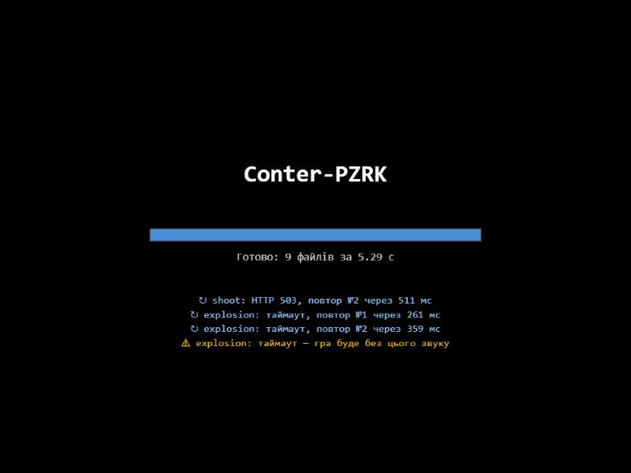
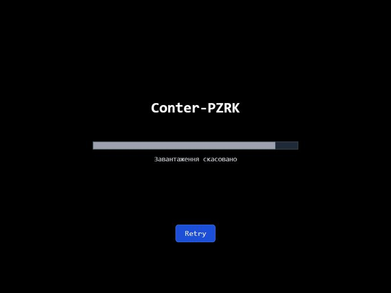
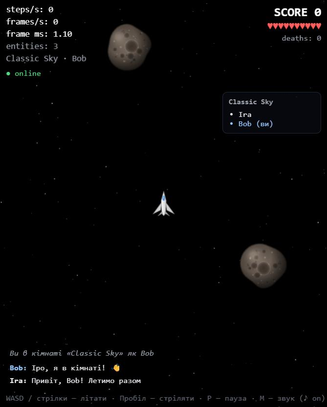
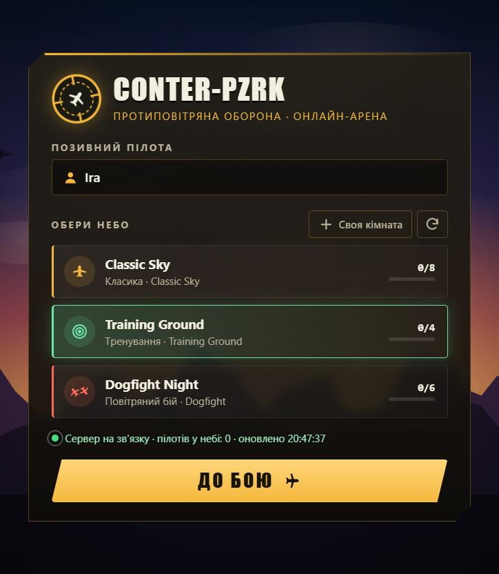
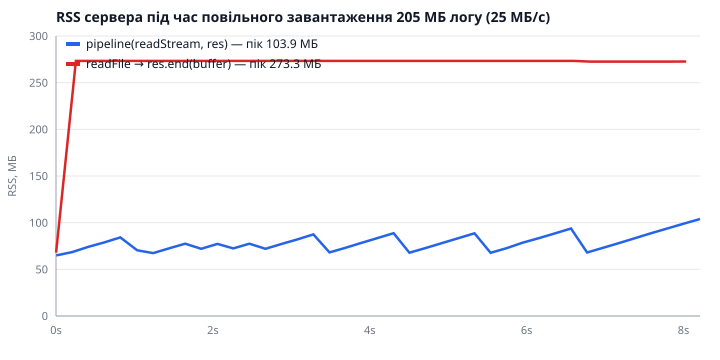

# Conter-PZRK
This is my super project about portable anti-aircraft missile system

---

Lab 1: Event Loop Is the Game Loop

## Що виконано

Зібрала ігровий цикл із фіксованим кроком симуляції (60/с) і корабель, яким можна керувати з клавіатури (WASD або стрілки). Корабель літає по canvas, повертається, прискорюється, гальмує за рахунок тертя, а при вильоті за край переміщується на протилежний край екрану.

Код розділений на окремі модулі: цикл (`loop.js`), введення (`input.js`), фізика корабля (`sim/ship.js`, `sim/arena.js`) та рендер (`render/canvas.js`,`render/draw.js`). Фізика повністю відокремлена від canvas.

## Milestone M1 - игровий цикл

Реалізовано через `requestAnimationFrame` з паттерном «акумулятор»: фізика рахується 60 разів/сек незалежно від частоти оновлення екрану, а відмальовування відбувається з тією частотою, яку підтримує монітор.
Різниця між двома станами фізики (попереднім і поточним) використовується для плавної інтерполяції під час рендеру (alpha від 0 до 1).

На моєму моніторі (частота оновлення: 144 Hz):
steps/s: стабільно ~60
frames/s: ~0.20

## Milestone M2 - введення та фізика

Введення реалізовано через замикання (`createInput`) - приватний стан натиснутих клавіш недоступний ззовні, доступ до нього здійснюється тільки через `isDown`/`justPressed`. Фізика корабля (`integrate`) - чиста функція без жодного звернення до DOM або canvas: вона приймає стан + введення + dt та повертає новий стан.

Керування - WASD та стрылки.


## Milestone M3 - інтерполяція та рендер

Рендер зберігає два стани корабля (previous/current) і малює корабель у проміжній позиції між ними за допомогою lerp. Для кута повороту використовується окрема функція lerpAngle, яка бере найкоротший шлях по колу. Інакше при переході через 0°/360° корабель різко «смикався» б у зворотний бік.

Окремо вирішила проблему інтерполяції під час переміщення корабля через край арени. Без цього виправлення корабель на мить «проїжджав» через весь екран по прямій при вильоті за межі, тому що інтерполяція чесно малювала шлях між старою позицією (біля краю) і новою (на протилежному боці).
Виправила це тим, що при виявленні переміщення через край у wrapAround примусово прирівнюю previousShip до нової позиції. Тоді інтерполяція для цього кадру нічого не «розтягує».

## Milestone M4 - три експерименти
### Експеримент 1: busy-wait в render

Додала `while (performance.now() < t + 100) {}` всередину render один раз на 60 кадрів: картинка завмирає ривками приблизно раз на секунду, HUD показує різке падіння frames/s у момент завмирання.

Так стається, бо JavaScript виконується однопоточно. Поки while займає стек, event loop не може передати керування нічому іншому - ні наступному кадру рендеру, ні обробці введення. Блокування синхронним кодом не можна обійти всередині того самого потоку. Можна або не виконувати такі довгі синхронні операції, або віддати їх Web API.

### Eксперимент 2: setInterval замість requestAnimationFrame

Замінила `requestAnimationFrame(frame)` на
`setInterval(() => frame(performance.now()), 16)`.

Частота кадрів стрибає замість тоо щоб зафіксуватися на 144Hz

При згортанні вкладки на 5 секунд setInterval продовжував працювати у фоні, а requestAnimationFrame майже зупиняється на неактивній вкладці, економлячи батарею.

Повернула requestAnimationFrame назад на своє заслужене місце.

### Експеримент 3: без фіксованого кроку (змінний timestep)

Тимчасово замінила акумулятор на simulate(delta), який викликається один раз за кадр, без циклу while і без фіксованого кроку.У DevTools сповільнила CPU (Performance -> CPU throttling -> 6x slowdown). Тримала W протягом декількох секунд. Під час цього позиції відрізняються - при змінному кроці результат фізики залежить від того, з якою частотою викликається кадр. Через це симуляція стає недетермінованою. І для нас це критично, тому що два гравці могли б бачити різну фізику.

Повернула фіксований крок назад. Після цього позиції при throttling і без нього збігаються, тому що фізика рахується однаковими фіксованими частинами часу незалежно від частоти кадрів.

## Керування

W / стрілка вверх - ру хвперед(ніс корабля)
A / стрілка вліво - поворот вліво
D / стрілка вправо - поворот вправо


---

# Lab 2: Objects, Prototypes, and `this` — сутності, кулі, колізії

## Що виконано

Гра перетворилась з «одного самолітика» на арену: мій літак стріляє, з країв екрана прилітають астероїди та ворожі літаки, вороги переслідують і стріляють у відповідь, з часом з'являються бонуси. Збиті астероїди розколюються на менші, збитий літак вибухає частинками, гравець через 2 с респауниться в безпечному місці. Очки, здоров'я і активні бонуси видно в HUD. Що більше очок — то більше ворогів одночасно (до 5).

Свою ідею з Lab 1 (самолітик з крилами, кабіною і анімованим полум'ям) залишила: тепер вороги — це той самий літак, але в темно-червоних кольорах і з полоскою HP над ним. Також додала зоряне небо на фоні, щоб рух було краще видно.

Нові модулі:

```txt
src/sim/
  vector.js      # Vector2 — незмінні (pure) методи
  entity.js      # базовий клас Entity: id, pos, vel, angle, radius, alive, kind
  ship.js        # Ship extends Entity — і гравець, і вороги; #hp, fire()
  bullet.js      # Bullet extends Entity — з TTL
  asteroid.js    # Asteroid extends Entity — дрейфує, відбивається від країв, розколюється
  pickup.js      # Pickup extends Entity — бонус, стоїть на місці
  explosion.js   # Explosion extends Entity — частинки, без колізій
  components.js  # КОМПОЗИЦІЯ: homing, контролери (мозок корабля), ефекти бонусів
  world.js       # World — менеджер сутностей на Map
  collision.js   # система колізій (детекція + правила реакції)
  spawner.js     # «режисер» хвиль: генерує астероїди, ворогів, бонуси
  random.js      # детермінований генератор випадкових чисел (seed)
```

У `sim/` як і раніше немає жодного звернення до DOM чи canvas. Це перевірила, запустивши всю симуляцію в Node без браузера (бот замість клавіатури): 2 хвилини гри, 7200 кроків, усе працює.

## Milestone M1 — `Vector2` і базовий `Entity`

`Vector2` має `add`, `sub`, `scale`, `length`, `normalize`, `rotate`, `dot`, `static fromAngle` (плюс `distanceTo`, `angle`, `clampLength`). Усі методи повертають **новий** вектор, `a.add(b)` ніколи не змінює `a`. Бонус від цього: для інтерполяції досить написати `prevPos = pos` — копіювати не треба, бо старий вектор ніхто не змінить. In-place варіантів поки не робила: на ~20–30 сутностях різниці не видно, виміряю в Lab 7.

`Entity` має приватний статичний лічильник:

```js
static #nextId = 1
#id = Entity.#nextId++
get id() { return this.#id }
```

Ззовні id можна лише прочитати, змінити — ні. Корабель з Lab 1 (простий об'єкт + функція `integrate`) переписала в `class Ship extends Entity` — рівно один рівень успадкування. Те саме для `Bullet`, `Asteroid`, `Pickup`, `Explosion` — усі напряму від `Entity`, глибше нікого немає.

**Тюнінг фізики.** У Lab 1 стояло `THRUST_POWER = 1e25` і `DRAG = 0.89`: літак миттєво набирав максимальну швидкість і миттєво зупинявся. Для куль це погано — куля успадковує швидкість літака, а «миттєва» швидкість робить це непомітним. Поставила `thrustPower = 900` px/с² і `DRAG = 0.97` за крок: літак розганяється приблизно за пів секунди і плавно гальмує десь за секунду. Вороги повільніші (`maxSpeed 190` проти `300`, поворот `2.6` проти `6` рад/с), щоб від них можна було втекти.

## Milestone M2 — світ на `Map`

`World` тримає `#entities = new Map()` (id → сутність) і має `spawn`, `despawn`, `get`, `[Symbol.iterator]` і генератор `*ofKind(kind)`:

```js
*[Symbol.iterator]() { yield* this.#entities.values() }
*ofKind(kind) { for (const e of this) if (e.kind === kind) yield e }
```

Рендер так і малює: `for (const b of world.ofKind('bullet')) drawBullet(...)` — без проміжних масивів.

`World.step(dt, input)` за один крок: зберігає попередній стан кожної сутності (для інтерполяції) → homing → `update` усіх → колізії → спавнер → прибирання мертвих.

Два моменти, де `Map` може підставити:

1. **Видалення.** `despawn(id)` нічого не видаляє, лише ставить `alive = false`. Справжнє видалення робиться в одному місці — `#sweep()` наприкінці кроку.
2. **Додавання.** Цього в завданні не було, але це легко пропустити: `for…of` по `Map` **бачить елементи, додані під час обходу**. Куля, випущена в `ship.update()`, оновилась би ще на цьому ж кроці (і пролетіла б зайвий крок). Тому все, що народжується під час кроку, спочатку йде в чергу `#pending` і додається в `Map` після кроку.

Чому `Map`, а не `{}`: ключі-числа залишаються числами (`{}` перетворює їх на рядки), є `.size`, порядок вставки гарантований, немає успадкованих ключів типу `constructor`, і він швидший при частих додаваннях/видаленнях — а кулі живуть усього 1.2 с.

`Ship.fire()` створює кулю біля носа літака, швидкість кулі = швидкість літака + 600 px/с у напрямку носа (inherited velocity). Затиснутий пробіл — 10 пострілів на секунду (`fireCooldown = 0.1` с), з бонусом R — 20.

### Баг з `this`

Відтворила навмисно в консолі DevTools: передала метод як callback, а не викликала його.

```js
window.addEventListener('keydown', game.player.fire)
// натискаємо будь-яку клавішу:
// Uncaught TypeError: Cannot read properties of undefined (reading 'has')
```

Що відбулося: браузер викликає обробник як `listener.call(window, event)`, тому всередині `fire` маємо `this === window`. `this.cooldown` у window немає (це `undefined`, тому перевірка кулдауну мовчки проходить), а потім `this.effects.has(...)` падає, бо `window.effects` — `undefined`.

Якщо просто «відірвати» метод від об'єкта, буде інша помилка:

```js
const fire = game.player.fire
fire(game.world)
// TypeError: Cannot read properties of undefined (reading 'cooldown')
```

Тут `this === undefined`, бо класи і модулі завжди в strict mode (правило default binding).

Головне правило: `this` визначається **в момент виклику**, а не тим, «чий це метод». Порядок правил: `new` → `call/apply/bind` → `obj.f()` (те, що зліва від крапки) → голий `f()` (`undefined` у strict).

Варіанти виправлення:

| Варіант | Плюс | Мінус |
|---|---|---|
| `() => ship.fire(world)` — обгортка-стрілка | найпростіше, видно, хто викликається | для `removeEventListener` треба зберегти посилання на обгортку |
| `ship.fire.bind(ship)` | `this` прив'язаний назавжди | кожен `bind` — нова функція; теж треба зберігати для `remove` |
| `fire = () => {…}` як поле класу | `this` завжди правильний, можна передавати куди завгодно | окрема функція в **кожному** екземплярі (не в прототипі) — для сотень об'єктів це зайва пам'ять |

**Що обрала я:** взагалі не підписувати методи кораблів на події. Клавіатура лише записує стан клавіш (`createInput` з Lab 1), а в кроці симуляції корабель сам викликає `this.fire(world)` — через крапку, тобто implicit binding, і `this` завжди правильний. До того ж стрільба тоді йде у фіксованому кроці симуляції, а не «коли прийшла подія» — це важливо для детермінізму і для мультиплеєра в Lab 5.

## Milestone M3 — колізії, шкода, респаун

`collision.js` розділений на дві частини:

- `findCollisions(world)` — генератор, який віддає пари `[a, b]`, що перетинаються (коло–коло, порівнюю квадрати відстаней, без `Math.sqrt`). Наївне O(n²).
- `resolveCollisions(world, pairs)` — правила реакції за парою типів: `'asteroid:bullet'`, `'bullet:ship'`, `'asteroid:ship'`, `'ship:ship'`, `'pickup:ship'`.

Функція детекції передається у `World` як параметр (`new World({ detectCollisions })`), тож у Lab 7 її можна замінити на spatial hash, не чіпаючи нічого іншого.

Правила:

- куля влучає в чужий літак (своїх не б'є) або в астероїд;
- великий астероїд має 3 HP, середній — 2, малий — 1; знищений розколюється на два менші;
- зіткнення з астероїдом: −1 HP літаку, астероїд руйнується;
- зіткнення двох літаків різних команд: обидва −1 HP і відштовхуються.

**`#hp` — приватне поле** у `Ship`, назовні тільки `get hp()`. Змінити здоров'я можна лише через `damage()` (і через респаун). Перевірила: `Object.keys(ship)` не містить `hp`, а `ship.#hp` поза класом — `SyntaxError` ще до запуску.

**Вибух** — сутність `Explosion` з 24–40 частинками, живе 0.9 с, без колізій.

**Респаун:** літак гравця не видаляється зі світу — він переходить у стан очікування (`respawnIn = 2`, `collidable = false`), а через 2 с з'являється в «безпечній» точці (`world.findSafeSpot()` — до 40 випадкових спроб знайти місце далі ніж 170 px від астероїдів, ворогів і куль). Ще 2 с після цього він невразливий і блимає. Вороги після смерті видаляються, а спавнер з часом присилає нових.

**Очки:** великий астероїд 20, середній 50, малий 100, ворожий літак 150.

**Баланс.** Спочатку в гравця було 3 HP, стрільба раз на 0.22 с і до 12 астероїдів одночасно — коли я пограла, виявилось, що вмираєш приблизно кожні 30 секунд і просто не встигаєш грати. Змінила:

| Параметр | Було | Стало |
|---|---|---|
| HP гравця | 3 | 10 |
| Пауза між пострілами | 0.22 с | 0.1 с (10 куль/с) |
| Швидкість кулі | 520 px/с | 600 px/с |
| Астероїдів на старті | 4 | 2 |
| Новий астероїд | кожні 3 с | кожні 7 с |
| Максимум астероїдів | 4 + рівень (до 12) | 2 + рівень/2 (до 5) |
| Самонавідних астероїдів | ~20% | ~10% |

Перевірила тим самим ботом у Node (стоїть на місці, повертається до найближчої цілі й стріляє), 2 хвилини гри: було 14 смертей, стало 2; астероїдів на екрані одночасно (разом з уламками) максимум 7 замість 14.

**Вигляд астероїдів.** Астероїди тепер схожі на справжні камені: нерівний скруглений контур, один великий кратер і кілька дрібних, пил і камінці на поверхні, а також об'єм — освітлена сторона (світло зверху зліва) і темна тінь з протилежного боку. Кратери «правильно» освітлені: стінка, ближча до світла, в тіні, а дальня — світла. Тінь від усього каменя рахується в екранних координатах, тому коли астероїд обертається, кратери крутяться разом з ним, а світло лишається з того самого боку. Положення кратерів генерується в симуляції з `world.rng` (як і форма контуру), тож це теж детерміновано. Самонавідні астероїди — розпечені червонуваті камені з червоним контуром.

**Детермінізм.** Усе випадкове в симуляції (форма астероїдів, де з'являються вороги, частинки) береться з `world.rng` із seed, а не з `Math.random()`. Перевірила в Node: два запуски по 2 хвилини з тим самим seed дають однакові позиції, очки і кількість смертей. `Math.random()` залишився лише у фоні зі зірками — це чисто декорація.

## Milestone M4 — композиція замість ієрархії

Дві фічі, які зламали б дерево класів:

**(a) Homing (самонаведення)** — один компонент і для кулі, **і** для астероїда:

```js
bullet.homing = homing({ turnRate: 5, targetKinds: ['ship', 'asteroid'], ownTeam: 'player' })
asteroid.homing = homing({ turnRate: 0.9, targetKinds: ['ship'], ownTeam: 'neutral' })
```

Це звичайний об'єкт з даними. Окрема система `homingSystem(world, dt)` проходить по всіх сутностях і, якщо в сутності є поле `homing`, повертає її швидкість у бік найближчої цілі (не більше `turnRate` рад/с, модуль швидкості не змінюється). Їй байдуже, куля це чи астероїд. Приблизно 10% нових астероїдів — маленькі червоні «самонавідні», а кулі стають самонавідними, коли гравець підбирає бонус **H**. Перевірка: постріл під 90° від цілі — звичайна куля промахується (HP цілі 3), самонавідна влучає (HP 2).

**(b) Pickup (бонус)** — стоїть на місці, з ним можна зіткнутись, але це не корабель. Який ефект він дає — просто рядок: `'shield'` (**S**, щит 6 с), `'rapid'` (**R**, скорострільність 6 с), `'homing'` (**H**, самонавідні кулі 8 с). На кораблі активні ефекти лежать у `ship.effects` — `Map<назва, секунд залишилось>`, і корабель просто питає `effects.has('rapid')`.

Так само зроблений **«мозок» корабля**: `ship.controller` — це рядок `'keyboard'` або `'chaser'`. Гравець і ворог — той самий клас `Ship`, відрізняються лише контролер і числа.

**Як виглядало б через успадкування:**

```txt
Entity
├── MovingEntity
│   ├── Bullet
│   │   └── HomingBullet          ← копія логіки наведення №1
│   ├── Asteroid
│   │   └── HomingAsteroid        ← копія логіки наведення №2
│   └── Ship
│       ├── PlayerShip
│       │   ├── ShieldedPlayerShip
│       │   └── RapidFirePlayerShip   ← а якщо щит І скорострільність одночасно?
│       └── EnemyShip
└── Pickup                         ← не рухається, але колізії потрібні
```

Проблеми: логіка наведення дублюється у двох гілках (або потрібен спільний предок `HomingThing`, а з одним `extends` у Bullet уже є свій предок); комбінації бонусів дають вибух кількості класів; бонус діє 6 секунд — а клас об'єкта під час гри не поміняєш. Будь-яка нова ідея («астероїд, що стріляє») вимагає перебудувати дерево.

**Чому обрала композицію саме так (поведінка як дані):** компоненти — це прості поля з рядками і числами (`homing`, `effects`, `controller`), а логіка живе в системах (`homingSystem`, контролери, правила колізій). Додати/зняти поведінку під час гри — просто присвоїти або видалити поле. Плюс такі дані легко серіалізувати в JSON — у Lab 5 стан світу доведеться передавати по мережі, а функції і класи по мережі не передаш.

## Досліди з notes (консоль)

1. `b = Object.create(a)`: `b.hello` → `1`, `hasOwnProperty('hello')` → `false`, після `a.hello = 2` → `b.hello` теж `2`. Властивість не копіюється, а шукається вгору по прототипу — тому тисяча куль ділить один метод `update`.
2. `const m = a.m; m()` → `undefined` (default binding у strict mode), `m.call(a)` → `A {}`.
3. `{ 1: 'x' }`: `o[1]` і `o['1']` — обидва `'x'`, бо ключ став рядком. `Map`: `get(1)` → `'x'`, `get('1')` → `undefined`. Об'єкт як ключ у `{}` перетворюється на `'[object Object]'`.

## ESLint / Prettier

У Lab 1 ESLint і Prettier були встановлені, але не налаштовані. Додала `eslint.config.js` (flat config: `@eslint/js` recommended + `eslint-config-prettier`) і `.prettierrc`. Скрипти: `npm run lint` (0 помилок) і `npm run format`.

## Керування

W / стрілка вгору — тяга вперед
A / D або стрілки вліво/вправо — поворот
Пробіл — стріляти
P — пауза (зроблено через `justPressed`: одне натискання = одне перемикання)

Запуск: `npm install`, потім `npm run dev`.


---

# Lab 3: Asynchronous JavaScript — завантаження, лобі, звук

## Що виконано

Тепер гра починається не одразу, а як справжня: **екран завантаження** з прогрес-баром → **лобі** з кімнатами → **гра** зі спрайтами і звуком. Esc повертає з гри в лобі.


- Спрайт-листи (літаки, кулі, астероїди), 5 звуків і конфіг арен вантажаться **паралельно** через `Promise.all`, з прогресом по кожному файлу.
- Кожен запит має таймаут, повтори з експоненційною затримкою та jitter, і його можна скасувати.
- Якщо необов'язковий файл не завантажився, гра все одно стартує: замість спрайта малюється векторна графіка з Lab 1–2, замість звуку — тиша. Якщо не завантажився обов'язковий файл (конфіг арен), з'являється зрозуміле повідомлення і кнопка **Retry**.
- Лобі вантажить список кімнат по HTTP, оновлює його кожні 4 с, має таймаут 3 с і скасовує запити, щойно гравець виходить.
- Звук через Web Audio API, вмикається першим кліком/клавішею. Симуляція про звук нічого не знає — вона лише оголошує події.
- 3 арени з різними правилами: **Classic Sky**, **Training Ground** (мало ворогів, без самонавідних астероїдів), **Dogfight** (без астероїдів, до 6 ворогів).

Нові файли:

```txt
public/assets/
  manifest.json          # список усіх ассетів + кадри спрайт-листів
  arenas.json            # параметри арен (обов'язковий ассет)
  sprites/*.svg          # спрайт-листи (згенеровані скриптом)
  sounds/*.wav           # звуки (згенеровані скриптом)
  broken.json            # навмисно зіпсований JSON для тестів
public/api/rooms.json    # "сервер" лобі (у Lab 4 його замінить Node-сервер)
scripts/
  make-sprites.mjs       # генерує SVG-спрайти
  make-sounds.mjs        # синтезує WAV-звуки
src/
  assets/loader.js       # fetchJson, withRetry, loadImage/Audio/Json, loadAll
  assets/test-flags.js   # навмисні збої для галереї помилок (?test=...)
  audio.js               # AudioContext, розблокування, підписка на події світу
  hud.js                 # HUD як підписник подій ("+50", банер бонусу)
  lobby/lobby.js         # class Lobby extends EventTarget — логіка без DOM
  lobby/lobby-view.js    # DOM-відображення лобі
  render/loading.js      # екран завантаження на canvas
tests/loader.test.js     # 13 тестів (node:test)
vite.config.js           # middleware: повільна/ненадійна мережа і справжній 404
```

**Спрайти і звуки я не брала з інтернету, а згенерувала кодом** (`npm run assets`): SVG-спрайти будуються з тих самих координат, що й мій векторний літак, а звуки синтезуються в WAV (постріл — квадратна хвиля з падінням частоти, вибух — шум через фільтр, бонус — три ноти вгору). Так немає проблем з ліцензіями, і все можна перегенерувати, змінивши пару чисел.

## Milestone M1 — конвеєр ассетів і екран завантаження

`src/assets/loader.js`:

- **`fetchJson(url, { signal, timeoutMs })`** — перевіряє `res.ok`. `fetch` НЕ відхиляє проміс на 404/500: сервер же відповів. Тому `!res.ok` я сама перетворюю на `HttpError`. Тіло читається окремим `await res.text()` (другий крок, який теж може впасти), а битий JSON стає `AssetFormatError`.
- **`loadImage`, `loadAudio(ctx, url)`, `loadJson`** — усі приймають `AbortSignal`. Картинка: `fetch → blob → Image → img.decode()`. Звук: `fetch → arrayBuffer → audioCtx.decodeAudioData()` (декодувати можна ще до кліку, поки контекст «suspended»).
- **Таймаут на кожну спробу:** `AbortSignal.any([signal, AbortSignal.timeout(ms)])`. Скасувала користувачка → `AbortError`, сервер не встиг → `TimeoutError`. Це різні помилки, і обробляються вони по-різному.
- **`withRetry(fn, { attempts, baseMs, signal })`** — експоненційна затримка з jitter: пауза після спроби *n* береться випадково з `[base·2ⁿ⁻¹/2, base·2ⁿ⁻¹]`. Jitter потрібен, щоб після падіння сервера тисяча клієнтів не прийшла знову в ту саму мілісекунду.

Що повторюємо, а що ні:

| Помилка | Повтор? | Чому |
|---|---|---|
| HTTP 500/503, 408, 429 | так | сервер тимчасово не справляється |
| мережа (`TypeError`), таймаут | так | з'єднання могло відновитись |
| HTTP 404, 403 та інші 4xx | **ні** | файлу немає — хоч 100 разів питай |
| битий JSON / картинка не декодується | **ні** | файл зіпсований, а не мережа |
| `AbortError` | **ні** | користувачка сама скасувала |

- **`loadAll(manifest, { onProgress, signal })`** — `Promise.all`, але кожен проміс обгорнутий у `.then(...)`, який рахує `done++` і викликає `onProgress`. Сам `Promise.all` нічого не каже до самого кінця, тому прогрес треба рахувати так. Необов'язкові файли (`"optional": true`) при помилці повертають `null` і записуються в `failed`. Обов'язкові та `AbortError` передаються далі, і тоді весь `Promise.all` відхиляється.
- **Екран завантаження** (`render/loading.js`) малюється на canvas у `requestAnimationFrame`, поки йде завантаження. На ньому справжній відсоток, час, останній файл, повтори (`↻`) і попередження (`⚠`). Гра стартує лише після `await loadAll(...)`.

### Паралельно vs послідовно

9 файлів, кожен сервер віддає з затримкою 400 мс (`?test=slowall`). Заміряла в браузері по 3 рази (`loadAll` проти `loadAllSequential`, у якому ті самі файли вантажаться в циклі `for` з `await`):

| | Запуск 1 | Запуск 2 | Запуск 3 |
|---|---|---|---|
| `Promise.all` (паралельно) | 824 мс | 831 мс | 831 мс |
| `await` по черзі | 3736 мс | 3728 мс | 3772 мс |

Послідовно в **~4.5 раза повільніше**: 9 × 400 мс = 3600 мс плюс накладні витрати. Цікаво, що паралельно вийшло не 400 мс, а дві «хвилі» по 400. Браузер тримає **не більше 6 одночасних HTTP/1.1-з'єднань з одним сервером**: спочатку йдуть 6 файлів, потім решта 3. Тобто `Promise.all` запускає всі запити одразу, але браузер сам ставить зайві в чергу.

## Milestone M2 — спрайти і звук

**Спрайти.** `drawImage(sheet, sx, sy, sw, sh, dx, dy, dw, dh)` — береться прямокутник з листа. Координати кадрів лежать у `manifest.json`: літак 128×128 малюється в 44×44, куля 32×32 → 13×13, астероїд 128×128 → під свій радіус.

З астероїдами була цікава проблема: у Lab 2 я зробила так, що камінь обертається, а **світло падає завжди зверху зліва**. Якщо просто обертати спрайт, тінь крутилася б разом з каменем. Тому астероїд збирається на маленькому допоміжному canvas: (1) малюю повернутий кадр, (2) зверху режимом `globalCompositeOperation = 'source-atop'` (малювати лише там, де вже є камінь) кладу НЕповернутий градієнт тіні, (3) копіюю результат на екран. У SVG-спрайті тому немає «запеченого» освітлення, а кратери намальовані нейтрально.

Якщо спрайт не завантажився, кожен тип сутності має запасний варіант — векторне малювання з Lab 1–2.

**Звук.** `audio.js` володіє `AudioContext`. Браузер не дає відтворювати звук до жесту користувача, тому контекст «розблоковується» (`ctx.resume()`) першим `pointerdown`/`keydown` або кліком Join. Кожен звук — новий `AudioBufferSourceNode` з уже декодованим буфером (декодування відбувається під час завантаження, а не під час гри). Щоб 20 пострілів на секунду не злились у гул, той самий звук не грає частіше, ніж раз на 30 мс. Маленький астероїд вибухає тихіше й вище (`playbackRate`), літак — на повну. M — вимкнути звук.

**Події замість імпортів.** `World` тепер `extends EventTarget` і оголошує `CustomEvent`-и:

| Подія | Коли | Хто слухає |
|---|---|---|
| `fired` | постріл | звук (свій / ворожий постріл) |
| `hit` | влучання без знищення | звук |
| `exploded` | знищено корабель або астероїд | звук (гучність залежить від розміру) |
| `pickup` | підібрано бонус | звук + HUD (банер «SHIELD!») |
| `score` | нараховано очки | HUD (спливаюче «+50», очки блимають) |

**У `src/sim/` немає жодного імпорту `audio.js` чи `hud.js`** — це перевіряє окремий тест (`tests/loader.test.js`, останній тест читає всі файли `sim/`). Тому симуляцію досі можна запускати в Node без браузера, і в Lab 4–5 вона зможе працювати на сервері, де немає ні звуку, ні екрана.

## Milestone M3 — лобі по HTTP


`class Lobby extends EventTarget` (`lobby/lobby.js`) — лише логіка, без DOM:

- `open()` створює `AbortController`, одразу викликає `refresh()` і ставить `setInterval` на кожні 4 с;
- `refresh()` робить запит з сигналом `AbortSignal.any([leave, AbortSignal.timeout(3000)])`, тобто запит переривається, якщо гравець пішов з лобі **або** сервер мовчить довше 3 с;
- `join(roomId, name)` перевіряє, що кімната існує і не заповнена, закриває лобі й оголошує `join`;
- `close()` викликає `controller.abort()` — **один сигнал прибирає і таймер, і запит у польоті**. Жодних «осиротілих» запитів.

Події: `rooms`, `error`, `loading`, `join`, `close`. Відображення (`lobby/lobby-view.js`) — окремий модуль, який просто слухає ці події й малює DOM. Назви кімнат приходять із сервера, тому лише `textContent`, ніякого `innerHTML`. Ім'я пілота зберігається в `localStorage`. Заповнена кімната (8/8) показується сірою, вибрати її не можна. Join запускає локальну гру з параметрами арени цієї кімнати.

Перевірка (`?test=lobbyslow`, сервер відповідає через 5 с):
- через 3 с лобі пише «Сервер не відповів за 3 с — спробую ще раз автоматично» (`stats.failed: 1`);
- натискаю Join, поки висить наступний запит → `stats.aborted: 1`, у вкладці Network запит позначений `(canceled)` / `net::ERR_ABORTED`.

Знайшла баг, поки робила лобі: у полі імені не друкувались пробіл і літери W/A/S/D, бо `input.js` з Lab 1 перехоплював клавіші для гри (`preventDefault` на пробілі). Виправила: якщо подія прийшла з `<input>`, гра її ігнорує.

І ще один баг у `loop.js`: `stop()` викликається зсередини кадру (Esc → лобі), але кадр наприкінці знову викликав `requestAnimationFrame(frame)`, і цикл не зупинявся. Додала прапорець `running`, а `start()` тепер скидає накопичений час, щоб після лобі не було ривка.

## Milestone M4

### (a) П'ять головоломок порядку виконання

Усі п'ять я запускала: 1–4 в Node, 5 у браузері (5 разів, порядок однаковий).

**1. `await` віддає керування**
```js
console.log('A')
async function f() {
  console.log('B')
  await null
  console.log('C')
}
f().then(() => console.log('D'))
console.log('E')
```
Вивід: `A B E C D`. Тіло `async`-функції до першого `await` виконується синхронно (`B`). `await null` ставить продовження в чергу мікрозадач, і функція повертає керування, тому `E` друкується раніше за `C`. `D` — ще одна мікрозадача після завершення `f`.

**2. `setTimeout` всередині `.then`**
```js
setTimeout(() => console.log('1'), 0)
Promise.resolve()
  .then(() => {
    console.log('2')
    setTimeout(() => console.log('3'), 0)
  })
  .then(() => console.log('4'))
queueMicrotask(() => console.log('5'))
```
Вивід: `2 5 4 1 3`. Спочатку всі мікрозадачі: `2`, потім `5` (стала в чергу раніше, ніж другий `.then`), потім `4`. Далі таймери в порядку постановки: `1` поставлений першим, `3` — лише під час мікрозадачі, тому він останній.

**3. Ассет, який уже завантажився**
```js
const loaded = Promise.resolve('ship.svg')
setTimeout(() => console.log('timer'), 0)
loaded.then((n) => console.log('then', n))
;(async () => {
  console.log('async start')
  const n = await loaded
  console.log('async got', n)
})()
console.log('sync end')
```
Вивід: `async start`, `sync end`, `then ship.svg`, `async got ship.svg`, `timer`. Навіть коли проміс уже виконаний, `.then` і `await` НЕ спрацьовують синхронно — завжди через мікрозадачу. `.then` підписався першим, тому й спрацював першим. Таймер — макрозадача, він чекає, поки черга мікрозадач спорожніє.

**4. `return` проміса з `async` коштує зайвих «тіків»**
```js
async function a() {
  return Promise.resolve('a')
}
async function b() {
  return 'b'
}
a().then((v) => console.log(v))
b().then((v) => console.log(v))
Promise.resolve()
  .then(() => console.log('c1'))
  .then(() => console.log('c2'))
  .then(() => console.log('c3'))
  .then(() => console.log('c4'))
```
Вивід: `b c1 c2 a c3 c4`. `b` повертає звичайне значення, і її проміс виконується одразу. `a` повертає **проміс**, тож рушію треба його «розпакувати»: спершу мікрозадача, що підписується на внутрішній проміс (`then`), потім ще одна, коли той виконується. Через це `a` відстає на 2 тіки від ланцюжка `c`.

**5. `requestAnimationFrame`** (браузер)
```js
requestAnimationFrame(() => {
  log('raf')
  Promise.resolve().then(() => log('raf-micro'))
  setTimeout(() => log('raf-timeout'), 0)
})
setTimeout(() => log('timeout'), 0)
Promise.resolve().then(() => log('micro'))
log('sync')
```
Вивід (5 запусків з 5): `sync micro timeout raf raf-micro raf-timeout`. Синхронне → мікрозадачі → таймер (наступна задача) → rAF виконується лише перед відмальовуванням кадру, а це до ~16 мс → мікрозадача з rAF виконується одразу після нього → таймер, поставлений у rAF, — аж після. Порядок `timeout` / `raf` специфікація не гарантує (залежить від того, коли буде кадр), але мікрозадачі завжди йдуть першими. І ще спостереження: коли вкладка була прихована, `raf` не спрацював зовсім — браузер не малює кадри для невидимої сторінки.

### (b) Галерея помилок

Усі збої вмикаються параметром адреси, наприклад `http://localhost:5173/?test=missing`. Затримки, 503 і 404 робить middleware у `vite.config.js`.

| Параметр | Що відбувається |
|---|---|
| `missing` | спрайт літаків → файл, якого немає |
| `slow` | спрайт астероїдів відповідає через 2.5 с |
| `slowall` | кожен файл відповідає через 400 мс |
| `timeout` | звук вибуху відповідає через 8 с при таймауті 1.5 с |
| `flaky` | звук пострілу двічі віддає 503, утретє — успіх |
| `badjson` | конфіг арен зіпсований |
| `abort` | завантаження скасовується через 1 с |
| `sequential` | вантажити по черзі замість `Promise.all` |
| `lobbyslow` | список кімнат відповідає через 5 с |

**1. Спрайт не знайдено (404)** — `?test=missing`


`HttpError 404` — без повторів (сенсу немає). Спрайт необов'язковий, тож гра стартує, а літаки малюються векторною графікою з Lab 1.

Тут я натрапила на цікаву річ: спочатку замість 404 була помилка «зіпсований файл». Виявилось, що dev-сервер Vite на **будь-яку** невідому адресу віддає `index.html` зі статусом **200** (так зручно для односторінкових застосунків). `fetch` отримував HTML і намагався декодувати його як картинку. Додала в middleware справжній 404 для відсутніх файлів у `/assets/` і `/api/`.

**2. Сервер тимчасово падає (503) і таймаут** — `?test=flaky,timeout`


Видно, як працює backoff з jitter: `shoot` двічі отримав 503 і пробував знову через 166 мс, потім 511 мс (експонента + випадковість), а з третьої спроби завантажився. `explosion` перший раз впав по таймауту і теж пішов на повтор.



Після 3 таймаутів по 1.5 с `explosion` здався. Звук необов'язковий, тож гра стартувала за 5.3 с, просто без звуку вибуху.

**3. Скасування посеред завантаження** — `?test=abort,slow`



8 з 9 файлів уже завантажились, повільний спрайт ще йшов — і тут `controller.abort()` (те саме робить кнопка Cancel). Запит обірвався (`net::ERR_ABORTED` у Network), `Promise.all` відхилився з `AbortError`, на екрані «Завантаження скасовано» і кнопка Retry. Повтору не було — скасування не помилка мережі.

**4. Зіпсований JSON** — `?test=badjson`


`arenas.json` обов'язковий: без нього не знати правил арени. `JSON.parse` падає → `AssetFormatError` (без повторів — файл зіпсований, а не мережа) → червоний екран з поясненням і кнопкою **Retry**. Retry запускає завантаження знову без навмисних збоїв (наче сервер виправили) — і гра доходить до лобі.

## Тести

`npm test` — 13 тестів на вбудованому `node:test` (Vitest буде в Lab 7), `fetch` підмінено фейком, мережа не потрібна:

- 503 повторюється до успіху; 404 і битий JSON — рівно 1 запит, без повторів; після `attempts` спроб помилка передається далі;
- мережева помилка (`TypeError`) і таймаут (`TimeoutError`) повторюються;
- паузи backoff ростуть як 4 → 8 → 16 мс (мінімум jitter) і 8 → 16 → 32 мс (максимум) при `baseMs = 8`;
- abort під час паузи між спробами зупиняє все;
- `loadAll`: прогрес на кожен файл; необов'язковий файл може впасти; обов'язковий — валить весь `loadAll`; паралельно швидше за послідовно;
- `src/sim/` не імпортує `audio`/`hud` і не звертається до `document`/`window`.

```txt
ℹ tests 13
ℹ pass 13
ℹ fail 0
```

## Керування (оновлено)

W / ↑ — тяга · A / D, ← / → — поворот · Пробіл — стріляти
P — пауза · M — вимкнути/увімкнути звук · Esc — вийти в лобі

Як запускати гру — див. розділ «Як запустити» в кінці Lab 4: тепер вона відкривається і через `npm run dev`, і через Live Server у VS Code, і просто за посиланням.

Команди: `npm run dev` — гра, `npm test` — тести, `npm run lint` — лінтер, `npm run assets` — перегенерувати спрайти і звуки.


---

# Lab 4: Node.js — сервер гри, кімнати, WebSocket, логи матчів

## Що виконано

У гри з'явився **справжній сервер на Node.js**. Лобі тепер бере кімнати з сервера (і можна створити свою), а в грі гравці однієї кімнати бачать одне одного у списку й переписуються в чаті через WebSocket. Усе, що відбувається в кімнаті, сервер стрімом пише на диск у лог матчу (NDJSON). Сам політ поки лишається локальним — синхронізація світу між гравцями буде в Lab 5.



*Вкладка Bob: у списку кімнати обидва гравці, Bob написав, Ira відповіла зі своєї вкладки.*

### Структура: npm workspaces

```txt
package.json            # "workspaces": ["client", "server"], спільні eslint/prettier
scripts/dev.mjs         # npm run dev — сервер (3000) і Vite (5173) одночасно
client/                 # гра з Lab 1–3 (переїхала сюди)
  src/net/connection.js #   обгортка WebSocket: черга, перепідключення з backoff
  src/net/room-view.js  #   список гравців, чат, стан з'єднання
server/
  package.json          # "type": "module", залежність ws
  .env.example          # конфіг (копія → .env, який у git не йде)
  src/
    index.js            # старт, SIGINT/SIGTERM → акуратне вимкнення
    app.js              # createGameServer(config): http + ws + кімнати + логи
    config.js           # PORT, HOST, LOG_DIR, ліміти — з process.env, з перевіркою
    http.js             # node:http: статика, /api/rooms, /api/replays, /health
    ws.js               # життєвий цикл сокета, heartbeat, rate limit, повільні клієнти
    protocol.js         # протокол v0: типи повідомлень, validate(), коди закриття
    rooms.js            # Room extends EventEmitter, RoomManager
    rate-limit.js       # token bucket
    log/matchlog.js     # події → Transform (object mode) → NDJSON → файл через pipeline
    log/replay.js       # async-генератор: читає NDJSON по рядку
  scripts/              # досліди: великий лог, backpressure, блокування циклу, падіння
  test/                 # 21 тест (node:test)
```

Усі вбудовані модулі імпортуються з префіксом `node:` (`node:http`, `node:stream/promises`…), щоб з першого погляду було видно, що це Node, а не пакет з npm. Скрізь ES-модулі (`"type": "module"`).

## Milestone M1 — HTTP-сервер

Без фреймворків, на голому `node:http`: хотілося побачити, що саме роблять за нас Express чи Fastify.

| Маршрут | Що робить |
|---|---|
| `GET /` і будь-який файл | статика з `client/dist` (продакшен-збірка) з правильним `Content-Type` |
| `GET /api/rooms` | список кімнат `{ rooms: [...] }` |
| `POST /api/rooms` | створити кімнату `{ name, arena }`; тіло ≤ 4 КБ, перевірка полів |
| `GET /api/replays`, `GET /api/replays/:id` | список логів і **стрімінг** файлу |
| `GET /health` | стан: аптайм, кімнати, гравці, `rssMB`, лічильники |

- **Захист від path traversal.** Шлях після `decodeURIComponent` + `path.resolve` має лишатися всередині `client/dist`, інакше 403. Цікаво, що `fetch` у тесті цю атаку навіть не відправив би: за стандартом URL він сам прибирає `../` і навіть `%2e%2e`. Тому тест шле «сирий» запит через `node:http` (`/..%2Fsecret.txt`, `/%2e%2e%2F…`, `/..%5C…` — останній зі зворотним слешем, актуально для Windows) і перевіряє 403.
- **Ліміт тіла запиту.** Тіло читається шматками з підрахунком байтів, при перевищенні 4 КБ — 413. Без ліміту можна надіслати гігабайт і покласти сервер по пам'яті. Битий JSON — 400, неправильні поля — 400 з поясненням, забагато кімнат — 409.
- **Конфіг з `process.env`** (`config.js`): кожне значення перевіряється, і помилка валить сервер одразу при старті з поясненням (`PORT must be an integer in [0, 65535], got "abc"`), а не мовчки посеред ночі. У розробці значення підставляє `node --env-file-if-exists=.env`.
- **Vite проксює** `/api`, `/health` і `/ws` на `localhost:3000`, тож у браузері все живе на одній адресі `localhost:5173`. У продакшені (`npm run build` → `npm start`) сервер сам віддає зібрану гру, ассети, API і WebSocket на одному порту — перевірила, що `/`, `manifest.json`, `.svg`, `.wav`, `/api/rooms`, `/health` віддаються з правильними типами, а невідоме — 404.
- **Graceful shutdown** (Ctrl+C = `SIGINT`, `SIGTERM` від Docker у Lab 8): перестати приймати нові з'єднання → закрити всі сокети з кодом 1001 → дочекатися, поки гравці «вийдуть» з кімнат → закрити кімнати (логи дописуються і файли закриваються) → `exit 0`. Якщо щось зависло довше 5 с — примусовий вихід.

  Тут тест знайшов справжній баг: спочатку я закривала кімнати одразу після `client.close()`, але закриття сокета асинхронне, тож кімнати закривались раніше, ніж гравці з них «виходили», і в лозі матчу губилися події `leave`. Тепер сервер спершу чекає закриття сокетів (максимум 2 с) і лише потім закриває кімнати.

## Milestone M2 — кімнати і WebSocket

**`Room extends EventEmitter`** нічого не знає ні про WebSocket, ні про диск. Вона тримає `players: Map` і оголошує `join`, `leave`, `chat`, `empty`, `close`, а ще `event` — те саме, але у вигляді даних для логу. **`RoomManager`** створює кімнати (з лімітом), знаходить їх і видаляє порожні за подією `empty`. Три стандартні кімнати (`persistent`) не видаляються.

**Протокол v0** (`protocol.js`) — JSON з полем `type`:

| Від клієнта | Від сервера |
|---|---|
| `{ type: 'join', v: 0, roomId, name }` | `welcome` — хто ти і де ти |
| `{ type: 'chat', text }` (≤ 200 символів) | `roster` — хто в кімнаті |
| `{ type: 'leave' }` | `chat`, `system` |

Сервер **не довіряє жодному повідомленню**: кожне проходить `validate()`. Що не так — закриваю сокет з кодом, і в лог сервера йде причина:

| Код | Причина |
|---|---|
| 4000 | не JSON |
| 4001 | невідомий `type` (зокрема `__proto__` — перевірка через `Object.hasOwn`) |
| 4002 | неправильна форма повідомлення |
| 4003 | не надіслав `join` за 5 с |
| 4004 | інша версія протоколу |
| 4005 | rate limit |
| 4006 | кімнати немає або вона заповнена |
| 4008 | повільний клієнт |
| 4009 | `chat` до `join` |
| 1009 | повідомлення більше `maxPayload` (ставить сама бібліотека `ws`) |

**`ws.js`**: стан кожного сокета (`{ id, player, room, bucket, … }`) лежить у `WeakMap`, тож він зникає разом із сокетом. Слухач `'error'` стоїть на **кожному** сокеті (чому це важливо — у M4). **Heartbeat**: кожні 15 с сервер шле `ping`. Хто пропустив 2 `pong` поспіль (вимкнений Wi-Fi часто не надсилає `close` взагалі), того сервер розриває через `terminate()`.

**Клієнт `connection.js`** (`class Connection extends EventTarget`):
- повідомлення з сервера стають подіями за `type`: `conn.addEventListener('roster', …)`;
- `send()` до відкриття з'єднання кладе повідомлення в **чергу** і надсилає її після `open`;
- при обриві (коди 1001/1006/1011…) — **перепідключення з експоненційною затримкою та jitter**, а `join` надсилається в `onOpen`, тож гравець сам повертається в кімнату. На коди 4000–4999 повторів немає: «кімната заповнена» чи «поганий протокол» від повтору не виправляться.

Перевірка в браузері: перезапустила сервер посеред гри → статус «зв'язок втрачено, спроба 1» → через ~50 мс знову «online», обидва гравці самі повернулися в кімнату.

**Лобі** з Lab 3 тепер ходить на справжній `GET /api/rooms` (у кімнатах видно реальну кількість гравців) і має форму «Створити кімнату» (`POST /api/rooms`). У грі Enter відкриває чат, Enter надсилає, Esc закриває поле (Esc поза полем — вихід у лобі, при цьому сокет закривається з кодом 1000).

**Новий дизайн лобі.** Перше, що бачить гравець, тепер виглядає як гра про ППО, а не як сіра форма. За панеллю живе небо (`render/lobby-bg.js`, малюється на canvas): захід сонця над горами, хмари, силуети літаків з інверсійним слідом і ракети ПЗРК, що злітають із землі й наводяться на літак (та сама логіка самонаведення, що й у грі). Панель — у стилі приладової таблички: зрізані кути, емблема-приціл, заголовок шрифтом Impact, янтарні акценти, поле «Позивний пілота», картки арен з іконками й кольором (Classic — янтарний, Training — зелений, Dogfight — червоний), смужка заповненості кімнати, індикатор зв'язку з сервером і велика кнопка «До бою». Іконки — власні SVG, без зовнішніх шрифтів і бібліотек, тож усе працює й офлайн.



Знайшла баг з чатом: після Enter поле відкривалося знову. Подія `keydown` з поля «спливала» до `window`, де той самий Enter знову відкривав чат. Виправила `stopPropagation()` для Enter/Esc у полі.

## Milestone M3 — логи матчів стрімами

Кожна кімната пише свій лог `logs/<кімната>-<час>.ndjson`:

```js
const events = on(room, 'event', { close: ['close'] })   // події EventEmitter як асинхронний ітератор
await pipeline(Readable.from(events), toNdjson(), createWriteStream(file))
```

- `toNdjson()` — `Transform` в object mode: на вхід об'єкт, на вихід рядок `JSON + '\n'`.
- `pipeline` з'єднує все, передає backpressure, передає помилки далі (не валить процес) і закриває файл.
- `close: ['close']` — коли кімната закривається, ітерація чесно закінчується, і `pipeline` дописує все до кінця. Перевірила, що події, які прийшли до `close`, теж записуються.
- Файл відкривається лише при **першій** події: порожня кімната не лишає порожніх файлів.

Приклад справжнього логу (Ira і Bob у Classic Sky):

```json
{"t":1795371015119,"room":"r-classic","type":"join","player":{"id":"2e073bcf","name":"Ira"}}
{"t":1795371032017,"room":"r-classic","type":"join","player":{"id":"d309f560","name":"Bob"}}
{"t":1795371032836,"room":"r-classic","type":"chat","player":{"id":"d309f560","name":"Bob"},"text":"Привіт, Іро! Це Bob 👋"}
```

**`replay.js`** — асинхронний генератор: `createReadStream` + `readline` → `JSON.parse` для кожного рядка. Пам'ять не залежить від розміру файлу. **`GET /api/replays/:id`** віддає файл через `pipeline(createReadStream(file), res)`, не завантажуючи його в пам'ять.

### Дослід: backpressure

`node scripts/make-big-log.js 200` згенерував лог на **205 МБ** (сам генератор теж пише через `pipeline`, тож при цьому займав лише 83 МБ пам'яті). `node scripts/backpressure-demo.js 25` піднімає окремий сервер і качає цей файл **повільним клієнтом** (25 МБ/с, як Network throttling у DevTools) двома способами, кожні 200 мс питаючи в сервера `rss` через `/health`:



| Спосіб | Час | RSS сервера |
|---|---|---|
| `pipeline(createReadStream(file), res)` | 8.2 с | 65 → **пік 104 МБ**, «пилка» 67–94 МБ |
| `readFile(file)` → `res.end(buffer)` | 8.2 с | одразу **273 МБ** і так до кінця |

Із `pipeline` пам'ять ходить «пилкою»: сервер читає шматок, відправляє, збирач сміття його прибирає. Але вона **не росте разом із розміром файлу**. Коли клієнт не встигає, `res.write()` повертає `false`, і `pipeline` ставить читання файлу на паузу до події `drain`. Це і є backpressure. Варіант з `readFile` одразу тримає в пам'яті весь файл. Десять таких завантажень одночасно — це вже 2 ГБ, і сервер падає. (Дані: `docs/lab-04/backpressure-rss.csv`.)

## Milestone M4 — захист від зловживань

- **Rate limit — token bucket** (`rate-limit.js`): у відрі до 20 жетонів (дозволений сплеск), щосекунди додається 10. Кожне повідомлення забирає жетон, немає жетона — закриття з 4005. Тест: 20 повідомлень підряд при burst 5 → 4005.
- **`maxPayload: 4096`** на `WebSocketServer` — бібліотека сама рве з'єднання з кодом 1009, ще до того, як ми розбираємо JSON. Плюс `protocol.js` додатково перевіряє 2 КБ на повідомлення.
- **Ліміти:** до 20 кімнат на сервер (409 при спробі створити 21-шу), до 8 гравців у кімнаті (4006 для дев'ятого).
- **Повільний клієнт** (`createSender` у `ws.js`): якщо `socket.bufferedAmount` > 256 КБ (сервер віддав дані, а мережа клієнта їх ще не забрала), некритичні повідомлення (чат) такому клієнту пропускаються, а критичні (склад кімнати) йдуть далі. Якщо черга > 1 МБ — сокет закривається з 4008. Інакше один клієнт на поганому інтернеті повільно «з'їдав» би пам'ять сервера.

## Цикл подій Node: блокування, backpressure, падіння

**Фази циклу подій Node** (libuv), по колу: **timers** (`setTimeout`/`setInterval`, у нас — heartbeat) → **pending callbacks** → **poll** (тут приходить I/O: нові HTTP-запити, дані WebSocket, шматки файлів — майже вся робота сервера) → **check** (`setImmediate`) → **close callbacks** (`socket.on('close')`). Між кожним колбеком виконуються `process.nextTick` і мікрозадачі промісів. Головне: як і в браузері (Lab 1), **весь JavaScript виконується в одному потоці**. Тисяча гравців обслуговуються по черзі, і це працює лише тому, що кожен обробник швидко завершується й віддає керування.

**Дослід з блокуванням** (`node scripts/block-demo.js`): двоє гравців у кімнаті, A шле повідомлення кожні 100 мс, міряю, за скільки воно доходить до B. На 1-й і 2-й секунді хтось викликає `GET /api/slow?ms=300`, а цей обробник крутить синхронний `while` 300 мс:

```txt
  t=1.0s     0.8 ms  █
  t=1.1s   275.0 ms  ███████████████████████████
  t=1.2s   166.9 ms  █████████████████
  t=1.3s    58.5 ms  ██████
  t=2.0s     0.8 ms  █
  t=2.1s   241.0 ms  ████████████████████████
  t=2.2s   133.6 ms  █████████████
  t=2.3s    25.8 ms  ███
звичайна затримка: медіана 0.8 ms, максимум 275 ms
/api/slow відповів за 352 ms і 302 ms
```

Поки один HTTP-запит крутить цикл, сервер **не робить нічого іншого**: повідомлення A вже лежить у мережевому буфері, але колбек `message` не може запуститися, бо стек зайнятий. Страждають усі гравці в усіх кімнатах, навіть ті, хто `/api/slow` не викликав. Heartbeat-таймер теж запізнюється. Повідомлення, що прийшли за ці 300 мс, обробляються пачкою відразу після розблокування (тому 275 → 167 → 58). Виправити це «зсередини» того самого потоку неможливо. Важку синхронну роботу треба або розбити на шматки, або винести в `worker_threads` чи окремий процес (Lab 7). (Повний вивід: `docs/lab-04/block-demo.txt`.)

**Де з'явився backpressure:** у M3. Файл читається з диска швидше (сотні МБ/с), ніж повільний клієнт його забирає (25 МБ/с). Без зворотного тиску різниця накопичувалась би в пам'яті сервера, як у варіанті з `readFile`. Той самий принцип у WebSocket: `bufferedAmount` — це черга, яку ми контролюємо політикою повільного клієнта.

**Чому один забутий `'error'` кладе весь сервер** (`node scripts/crash-demo.js …`, повний вивід у `docs/lab-04/crash-demo.txt`). У `EventEmitter` подія `'error'` особлива: якщо на неї ніхто не підписаний, `emit('error')` **кидає** помилку. Ніхто її не ловить, і процес завершується, разом з усіма кімнатами й гравцями:

```txt
$ node scripts/crash-demo.js emitter-no-listener
18:18:07.175 game tick 1: alice is still playing
18:18:07.284 game tick 2: alice is still playing
18:18:07.284 bob's connection dropped → bob.emit('error')
18:18:07.284 process exit, code 1
      throw er; // Unhandled 'error' event
Error: read ECONNRESET
(exit code 1)
```

У Bob пропав інтернет — а впала гра в Alice. Виправлення — слухач `'error'` на кожному сокеті (у `ws.js` він стоїть першим рядком після підключення):

```txt
$ node scripts/crash-demo.js emitter-with-listener
18:18:08.857 bob's connection dropped → bob.emit('error')
18:18:08.857 socket error handled: ECONNRESET — closing this socket only
18:18:08.966 game tick 3: alice is still playing
18:18:09.075 server survived, alice finished the match
(exit code 0)
```

Те саме з **необробленим reject**: з Node 15 процес за замовчуванням завершується з кодом 1 (`rejection` → exit 1, з `.catch()` → exit 0). У браузері (Lab 3) необроблений reject — лише попередження в консолі: вкладка належить одному користувачеві. А сервер, що продовжує працювати в невідомому стані, небезпечніший, ніж сервер, який упав і перезапустився. Тому в `index.js` є `process.on('unhandledRejection')`, який логує причину і завершує процес (у Lab 8 його перезапустить Docker), а всі потоки з'єднані через `pipeline`, який передає помилки в проміс замість події `'error'` без слухача.

## Тести

`npm test` у корені запускає обидва пакети: **13** тестів клієнта (Lab 3) і **21** тест сервера (`node:test`, справжній сервер на випадковому порту, справжні HTTP і WebSocket):

- протокол: кожен вид поганого повідомлення має свій код; `Room`/`RoomManager`: події, ліміти, видалення порожніх; token bucket; конфіг;
- лог матчу: події → NDJSON → назад через `readReplay`; порожня кімната не лишає файлу;
- HTTP: `/health`, `GET/POST /api/rooms`, 400/413, path traversal → 403;
- WebSocket: **двоє гравців бачать одне одного і чат**; join timeout → 4003; не JSON → 4000; невідомий тип → 4001; чат до join → 4009; неіснуюча кімната → 4006; спам → 4005; завелике повідомлення → 1009;
- повільний клієнт: чат пропускається, критичне надсилається, зовсім повільного відключено;
- graceful shutdown: клієнт отримує 1001, лог дописаний до кінця (`join`, `leave`, `close`).

## Як запустити

```txt
npm install          # (або npm.cmd install, якщо PowerShell блокує скрипти)
npm run dev          # сервер :3000 + гра :5173 → відкрити http://localhost:5173
npm test             # усі тести
npm run build && npm start   # продакшен: усе на http://localhost:3000
```

Щоб побачити двох гравців — відкрий http://localhost:5173 у двох вікнах, обери одну кімнату з різними іменами. Enter — чат.

### Три способи запустити гру

| Спосіб | Що працює | Як |
|---|---|---|
| **`npm run dev`** (повна версія) | усе: сервер, кімнати з реальними гравцями, створення кімнат, чат, логи матчів | `npm install`, `npm run dev` → http://localhost:5173 |
| **Live Server у VS Code** | гра повністю (спрайти, звук, вороги, бонуси, арени), лобі в **офлайн-режимі**: одиночна гра без чату | правою кнопкою на `index.html` у корені → *Open with Live Server* (або кнопка *Go Live*) |
| **за посиланням** (GitHub Pages чи будь-який статичний хостинг) | те саме, що й Live Server, нічого не треба встановлювати | відкрити посилання в браузері |

Як це влаштовано:

- **`index.html` у корені** лише переадресовує на `client/index.html`. Live Server і GitHub Pages віддають репозиторій «як є», тому без цього файлу вони показували `Cannot GET /index.html`: сама гра після Lab 4 переїхала в `client/`.
- **Ассети шукаються у двох місцях.** Під Vite і нашим сервером папка `public/` стає коренем сайту (`/assets/manifest.json`), а статичний сервер віддає її як звичайну папку (`client/public/assets/manifest.json`). Гра пробує перше місце, на 404 — друге. Адреси всередині маніфесту відносні (`sprites/ships.svg`) і рахуються від того місця, де знайшовся маніфест, тож гра працює навіть з підпапки (на GitHub Pages сайт живе за адресою `…github.io/Conter-PZRK/`).
- **`import.meta.env`** існує лише під Vite, тому в коді `import.meta.env?.DEV ?? false`, інакше без Vite гра падала б з `TypeError` ще до старту.
- **Офлайн-режим лобі.** Якщо `/api/rooms` жодного разу не відповів (404 від статичного сервера, мережева помилка), лобі показує три стандартні арени для одиночної гри і пише «Сервер недоступний — офлайн-режим». WebSocket у такому режимі не відкривається взагалі: на Live Server за адресою `/ws` живе його власний сокет автоперезавантаження сторінки, і наш `join` пішов би йому. Інтервал далі перевіряє сервер, і щойно той з'явиться, лобі саме перейде в онлайн.

Перевірила всі способи: статичний сервер із кореня проєкту (як Live Server, порт 5500) → переадресація, ассети з `client/public/`, офлайн-лобі, гра стартує, без жодного запиту до `/ws`; той самий сервер з підпапкою `/Conter-PZRK/` (як GitHub Pages) → усе знайдено; `npm run dev` → онлайн-кімнати й чат; продакшен `npm start` → онлайн.

**Як увімкнути посилання на GitHub Pages** (один раз, у браузері): репозиторій на GitHub → *Settings* → *Pages* → *Source: Deploy from a branch* → *Branch: main*, папка */ (root)* → *Save*. Через хвилину-дві гра відкриватиметься за адресою **https://louis25092006.github.io/Conter-PZRK/**.


---

# Lab 5: Real-Time Networking — авторитетний сервер, передбачення, бінарний протокол

## Що виконано

Тепер це справжній мультиплеєр: усі гравці кімнати літають в **одному світі**, бачать літаки одне одного, ворогів, астероїди й кулі, і разом відбиваються від ворожої авіації (кооператив, очки в кожного свої). Світ рахує **лише сервер**. Клієнт надсилає тільки натиснуті клавіші, а свій літак **передбачає**, тому на 150 мс пінгу керування відчувається миттєвим.

Відкрий http://localhost:5173 у двох вікнах і зайди в одну кімнату. Або відкрий **http://localhost:5173/duo.html**: там два клієнти поруч в одному вікні (ліворуч керуєш ти, праворуч літає бот), обидва з імітацією поганої мережі 100 ± 30 мс і 2% втрат.

```txt
shared/                    # НОВИЙ пакет (npm workspace) — спільний для клієнта й сервера
  src/sim/                 #   симуляція з Lab 2–3 (переїхала з client/src/sim)
    ship-physics.js        #   stepShip() — чиста фізика літака: та сама на сервері й у передбаченні
    hash.js                #   хеш стану світу — перевірка детермінізму
  src/net/snapshot.js      #   знімок світу як прості дані + події тіку
  src/codec/binary.js      #   бінарний протокол v1 на DataView (специфікація — у коментарі на початку)
  src/codec/index.js       #   jsonCodec і binaryCodec з однаковим інтерфейсом
  test/                    #   9 тестів: чистота, детермінізм, передбачення біт-у-біт, кодеки
server/src/
  match.js                 # Match: авторитетна симуляція кімнати, 30 тіків/с, точний таймер
  netsim.js                # імітатор мережі: затримка, джитер, втрати
  ws.js                    # + команди, знімки кожному клієнту, ping/pong, netsim
client/src/
  net/net-game.js          # онлайн-гра: передбачення, звірка, згладжування, інтерполяція
  net/netgraph.js          # нетграф і повзунки імітатора мережі
  game/offline-game.js     # одиночна гра (немає сервера) — той самий спільний світ локально
  game/camera.js           # арена фіксована 1600×900, камера вписує її у вікно
  game/commands.js         # клавіатура → команда; бот (?bot=1)
client/duo.html            # два клієнти поруч — для перевірки й демо
server/scripts/
  net-harness.js           # СПРАВЖНІЙ клієнт (net-game.js) у Node: заміри передбачення/звірки
  codec-bench.js           # таблиця JSON vs binary при 4 гравцях
```

**Чому спільний пакет імпортується по-різному.** Сервер підключає його як пакет `@conter/shared/...` (npm workspaces кладуть посилання в `node_modules`). Клієнт — відносним шляхом `../../shared/src/...`, бо гра має відкриватися ще й через Live Server і GitHub Pages (Lab 4), а там немає ні Vite, ні `node_modules`, і браузер голі імена пакетів не розуміє. Vite відносні шляхи за межі `client/` дозволяє, бо бачить корінь workspace.

## Milestone M1 — спільна симуляція, тік сервера

- **`shared/`**: симуляція, seeded PRNG (`random.js`, з Lab 2), протокол і кодеки. Тест обходить усі файли `shared/src` і перевіряє, що там немає `document`/`window`/`localStorage`, вбудованих модулів `node:` і `Date.now()`, тож пакет однаково працює і в браузері, і в Node.
- **Детермінізм**: два прогони по 1800 кроків (30 с гри, два літаки, вороги, астероїди) з тим самим seed і командами дають однаковий хеш стану. Інший seed дає інший хеш.
- **Арена тепер фіксована, 1600×900.** Раніше арена дорівнювала розміру вікна браузера, а в мультиплеєрі в кожного гравця вікно своє. Камера (`game/camera.js`) вписує арену у вікно зі збереженням пропорцій.
- **`Match`** (`server/src/match.js`) для кожної кімнати: стартує з першим гравцем, зупиняється з останнім. 30 разів на секунду застосовує команди, робить 2 кроки `world.step(1/60)` і розсилає знімок. Один крок = одна команда гравця.
- **Точний таймер.** `setInterval(tick, 33)` «пливе»: 33 ≠ 33.33, і затримки накопичуються. Тому кожен тік плануємо до **абсолютного** часу: `next += 1000/30; setTimeout(loop, next - performance.now())`. Тест: за 1 секунду 28–31 тік. Тривалість і джитер тіку видно в `GET /api/stats` (на моєму ПК: тік рахується в середньому за 0.28 мс, максимум 1.9 мс, при бюджеті 33 мс; середній інтервал між тіками 33.38 мс, джитер ~4 мс).
- **Команди мають `seq`**, знімки мають `tick` і `ack` (останній `seq` цього клієнта, який сервер застосував) — для кожного клієнта свій.
- **Перевірка команд на сервері**: лише `turn ∈ {-1, 0, 1}` і булеві `thrust`/`fire`. `turn: 5` → закриття з кодом 4002. Окремий token bucket для команд (90/с, сплеск 150) і для решти (10/с).
- **Імітатор мережі** (`netsim.js`): параметри з адреси сокета `/ws?lag=100&jitter=30&drop=0.02` або «на льоту» повзунками нетграфа (повідомлення `netsim`). `lag` — додаткова затримка туди-і-назад (по половині в кожен бік), `jitter` — випадкова добавка, `drop` — частка **знімків**, що губляться. Команди не губляться, бо WebSocket працює поверх TCP, а TCP не губить, лише запізнюється.
- **Нетграф** (у звичайній грі схований, **N** — показати/сховати; відкривається одразу, якщо в адресі є `?lag=…` або `?netgraph=1`, як у duo.html): RTT (ping/pong кожні 0.5 с), вік останнього знімка й інтервал між ними, трафік вниз/вгору (KB/с), розмір знімка, кількість непідтверджених команд, поправка звірки (зараз, максимум за 2 с і графік), затримка інтерполяції, параметри імітатора.

**Без передбачення** (`?predict=0`, «тупий клієнт») літак рухається лише тоді, коли прийде знімок. При 100 ± 30 мс натиснутий «газ» стає видимим через **187 мс** (`net-harness.js --nopredict`). На практиці це схоже на керування літаком через вату: розвертаєшся, а він ще пів секунди летить по-старому.

## Milestone M2 — передбачення і звірка

Ключ до всього — **`stepShip()`** (`shared/src/sim/ship-physics.js`): фізика літака як чиста функція над простими числами. Її викликає і сервер (`Ship.update`), і клієнт. Порядок операцій той самий, константи ті самі, тому результат однаковий до останнього біта. Тест крутить справжній `Ship` у світі і `stepShip` на простих числах 600 кроків з тими самими командами й перевіряє `deepEqual`, тобто **точну** рівність, а не «приблизно».

На кожен крок клієнт (`net-game.js`):
1. надсилає команду `{ seq, turn, thrust, fire }` і кладе її в буфер непідтверджених;
2. одразу застосовує її до свого літака тією ж `stepShip` — літак реагує миттєво.

На кожен знімок:
1. бере стан свого літака **від сервера** (на момент `ack`);
2. викидає з буфера всі команди з `seq ≤ ack`;
3. заново застосовує решту — отримує, де сервер скаже, що літак буде, коли ці команди дійдуть;
4. якщо це не там, де передбачав (зіткнення, якого клієнт не знав), — **згладжування**: візуально лишаємось на місці й під'їжджаємо за ~100 мс. Поправку більшу за 80 px (респаун) не згладжуємо.

Результати (`node scripts/net-harness.js`, 8 с польоту з поворотами при 100 ± 30 мс і 2% втрат, повний вивід у `docs/lab-05/net-harness.txt`):

| | Передбачення | Гравець бачить рух через | Поправки, px (180 знімків) | Непідтверджених команд |
|---|---|---|---|---|
| `--nopredict` | вимкнено | **187 мс** | — | — |
| звичайний режим | увімкнено | **0 мс** | **180 з 180 = 0**, max 0 | ~9.5 (≈ RTT 160 мс × 60/с) |
| `--nondet` (`Math.random()` у фізиці клієнта) | увімкнено | 0 мс | 0 з 180 нульових, медіана 2.6, max **13.5** | ~9.5 |

**Дослід зі зламаним детермінізмом.** `?test=nondet` у браузері (або `--nondet` у замірі) додає `Math.random()` до тяги в `stepShip`, але лише на клієнті. Передбачення на кожному кроці трохи розходиться з сервером, і графік поправок у нетграфі з рівної лінії на нулі перетворюється на суцільну «пилку» 2–13 px: літак весь час злегка смикається. Прибрала прапорець — знову рівний нуль.

### Справжні баги детермінізму, на які я натрапила

Ідеальні нулі вийшли не з першого разу. Поправки в 3–5 px з'являлись лише при джитері, і всі були ≈ 5 px = 300 px/с × 1/60 с, тобто **рівно один крок**. Розбиралась по черзі:

1. **Сервер «домальовував» рух.** Коли команда ще не дійшла, сервер повторював попередню. Тоді він робив для літака зайвий крок, а коли команда приходила — ще один. Виправлення: немає команди — літак на цьому кроці **чекає** (`SKIP`), і кожна команда дає рівно один крок і там, і там.
2. **Черга на сервері лише росла.** Після затримки команди приходять пачкою, а сервер бере по одній на крок, тож запізнення накопичувалось назавжди. Виправлення: за кожен пропущений крок гравець отримує «кредит» (до 10). Коли приходить пачка, сервер застосовує зайві команди одразу, витрачаючи кредит. Застосованих команд ніколи не більше, ніж минуло кроків + 10, тому прискоритись, шлючи команди частіше, неможливо — це перевіряє тест «90 команд/с замість 60 не прискорюють літак» (застосовано ≤ 610 за 600 кроків, решта відкинута).
3. **Імітатор мережі міняв повідомлення місцями.** Найхитріший: у кожного повідомлення був свій `setTimeout`, а Node округлює затримку до цілих мілісекунд. Пізніше повідомлення з трохи меншою затримкою іноді спрацьовувало раніше, команди мінялись місцями, і сервер відкидав «застарілу» (з меншим `seq`). У справжньому TCP такого не буває, тому переписала імітатор на FIFO-чергу з одним таймером. Після цього: **180 з 180 поправок = 0** навіть з джитером.

Ще один момент, який тестування показало: перевіряти мережевий код у **прихованій** вкладці браузера не можна. Браузер не викликає `requestAnimationFrame` і «душить» таймери, а потім ігровий цикл видає сотні команд разом, і сервер справедливо кікає за rate limit. Тому всі заміри я робила `net-harness.js`, який запускає **той самий** `client/src/net/net-game.js` у Node: там є вбудований `WebSocket`, а код клієнта не залежить від DOM.

## Milestone M3 — інтерполяція і другий гравець

**Чужі літаки** (і вороги, астероїди, кулі) малюються **в минулому**: клієнт тримає буфер останніх знімків і для часу `зараз − interpMs` знаходить два знімки навколо нього, а позицію бере між ними. Час сервера клієнт оцінює як `tick × 33.3 мс + зсув` (зсув згладжено, бо знімки приходять нерівно).
- Сутність з'явилась між знімками — малюємо там, де вона є в новішому. Зникла — не малюємо.
- Перелетіла через край арени (різниця > пів арени) — не інтерполюємо, інакше вона «пролетіла» б через увесь екран.
- Якщо знімка «з майбутнього» немає (затримка замала або знімок загубився), стоїмо на останньому, і лічильник `starved` у нетграфі це показує.

**Свої кулі передбачаються**: з'являються одразу при пострілі (той самий `muzzle()`, що й на сервері) і летять локально. Сервер позначає кожну кулю номером команди, якою її випущено (`spawnSeq`). Поки куля є на сервері, малюємо свою передбачену. Сервер її прибрав (влучила) — прибираємо й ми. Сервер так і не випустив — теж прибираємо. Самонавідні кулі не передбачаємо: їхню траєкторію знає лише сервер.

**Затримка інтерполяції — 100 мс** (повзунок `interp` у нетграфі, параметр `?interp=`). Між знімками 33 мс, тож 66 мс (два інтервали) — мінімум, щоб завжди мати пару знімків. Ще +33 мс — запас на джитер ±30 мс і на один загублений знімок із 50 (2%). Менше 60 мс — чужі літаки починають «стрибати» (`starved` росте). Більше — плавно, але чужі літаки й кулі видно все далі в минулому: на 300 мс ворог уже не там, куди ти цілишся. Сервер рахує влучання за **своїм** станом, тож чим більша затримка, тим частіше «я ж у нього попав». Компенсація лагу (сервер «перемотує» світ на момент пострілу) — це Stretch лаби.

**Звук, вибухи, «+50»** працюють і онлайн: сервер разом зі знімком надсилає події тіку (`fired`, `hit`, `exploded`, `pickup`, `score`), а клієнт за ними грає звук, малює вибух і показує очки. Свій постріл озвучується одразу при передбаченні, тому серверну подію про нього клієнт пропускає. Над літаками інших гравців видно їхні імена.

## Milestone M4 — бінарний протокол і заміри

Специфікація — коментар на початку `shared/src/codec/binary.js`. Коротко:
- **little-endian скрізь**, у кожному повідомленні тип і версія (`version = 1`, чужа версія → помилка);
- **команда — 8 байтів**: `u8 тип, u8 версія, u32 seq, i8 turn, u8 кнопки` (біт 0 газ, біт 1 постріл);
- **знімок**: заголовок 17 байтів (`tick`, `ack`, `you`, кількість сутностей і подій), далі сутності: спільна частина 15 байтів (`u32 id, u8 kind, f32 x, f32 y, i16 кут`) + своя частина (літак +28, куля +10, астероїд +3, бонус +2), потім події по 18 байтів;
- **кут квантується** в `i16` у тисячних радіана (2 байти замість 8, похибка ≤ 0.0005 рад — оком не видно). А от `cooldown` літака лишила точним `f32`: від нього залежить, на якому кроці передбачення вистрілить, і округлення давало б зайві/зниклі кулі;
- клієнт: `socket.binaryType = 'arraybuffer'`; сервер отримує `Buffer`, а це `Uint8Array`, що може дивитися в **середину** спільного пулу пам'яті. Тому `DataView` створюється з `byteOffset` (на це є окремий тест).

Тести кодека: `decode(encode(знімок))` дорівнює оригіналу в межах квантування (кут порівнюється по колу: 7.23 рад і 0.95 рад — той самий напрямок), команда — точний round-trip, чужа версія → помилка, бінарний знімок щонайменше втричі менший за JSON. JSON-кодек лишився за прапорцем `?codec=json`.

**Таблиця: 30 Гц, 4 гравці** (`node scripts/codec-bench.js`: хвилина справжньої гри, 4 літаки-боти + вороги + астероїди + кулі, у середньому 28 сутностей у знімку):

| Codec | Bytes/snapshot (avg / max) | KB/s per client (down) | KB/s per client (up) | Encode+decode µs |
|---|---|---|---|---|
| JSON | 5185 / 9966 | 151.9 | 3.87 | 45.9 |
| Binary (`DataView`) | 794 / 1542 | **23.3** | **0.47** | **7.4** |

Бінарний знімок **у 6.5 раза менший** і кодується+декодується **у 6 разів швидше**. Команда: 66 байтів JSON проти 8 байтів. У живій грі (кімната Training, 1 гравець) нетграф показував 18.3 KB/с з JSON і 2.7 KB/с з бінарним.

## Мережевий код: три проблеми

**1. Затримка.** Сигнал до сервера й назад іде ~150 мс, і чекати на нього при кожному натисканні неможливо (187 мс «вати», див. M1). Рішення — **передбачення**: свій літак рахуємо одразу самі тією ж функцією, що й сервер. Чужих бачимо із запізненням ~100 мс (**інтерполяція**). Це чесний компроміс: плавність замість ривків, ціною того, що чужих видно трохи в минулому.

**2. Узгодженість.** Двоє гравців мусять бачити один світ. Рішення: правда одна — **сервер**. Клієнт лише пропонує команди, а сервер вирішує, що сталося. Передбачення не сперечається з сервером, а **звіряється** з ним на кожному знімку (стан сервера + повтор непідтверджених команд). Щоб звірка давала нулі, симуляція **детермінована**: seeded PRNG замість `Math.random()`, фіксований крок, жодного `Date.now()`, одна функція фізики на двох. Це перевіряють тести (хеш стану, рівність біт-у-біт), а нетграф показує в реальному часі (графік поправок).

**3. Шахрайство.** Клієнту не можна вірити. Рішення: клієнт **ніколи не надсилає позиції**, лише натиснуті клавіші. Сервер перевіряє кожну команду (`turn: 5` → відключення), обмежує частоту (token bucket), а одна команда завжди дає рівно один крок фізики з кредитом не більше 10 кроків. Тож ні телепорт, ні «швидкість ×1.5» від частіших команд неможливі (обидва випадки покриті тестами). Поки що сервер довіряє клієнту лише в одному: в якому порядку той натискав клавіші.

**Що показав нетграф до і після.** Без передбачення (`?predict=0`) літак відгукується через ~190 мс. З передбаченням — одразу, поправки рівні нулю. Зі зламаним детермінізмом поправки стоять «пилкою» 2–13 px. При змінах повзунків `lag`/`jitter` росте лише RTT і кількість непідтверджених команд (≈ RTT × 60/с), а поправки лишаються нульовими. Отже, передбачення працює саме так, як задумано.

## Тести

`npm test` у корені: **9** (`shared`) + **13** (`client`) + **33** (`server`) = **55**. Нові для Lab 5:
- `shared`: чистота пакета, детермінізм (хеш), передбачення = сервер біт-у-біт, зламаний детермінізм розводить стани, round-trip кодеків, `Buffer` зі зсувом, чужа версія, binary ≥ 3× менший;
- `server`: бінарні команди рухають літак і `ack` доходить до 60, ~30 знімків/с, JSON-кодек, чит `turn: 5` → 4002, бінарне сміття → 4002, ping/pong, `/api/stats`, двоє гравців бачать літаки одне одного, точний таймер 30 Гц, дублікати й переповнення черги, наздоганяння після затримки, захист від спідхаку, імітатор мережі не міняє порядок і губить лише знімки.

## Як запустити й дослідити

```txt
npm install && npm run dev            # сервер :3000 + гра :5173
http://localhost:5173/duo.html        # два клієнти поруч (ліворуч — ти, праворуч — бот), 100±30 мс, 2% втрат
http://localhost:5173/?lag=150&jitter=40&drop=0.05   # власні параметри мережі
http://localhost:5173/?predict=0      # "тупий клієнт" без передбачення
http://localhost:5173/?test=nondet    # зламаний детермінізм
http://localhost:5173/?codec=json     # JSON замість бінарного

cd server
node scripts/net-harness.js --lag 100 --jitter 30 --drop 0.02 [--nopredict | --nondet | --codec json]
node scripts/codec-bench.js
```

Керування як раніше. Нове: **N** — нетграф і повзунки мережі. Пауза (P) лише офлайн: зупинити сервер заради одного гравця не можна.

# Lab 6: TypeScript — strict, один протокол на двох, типізовані події

## Що виконано

Увесь проєкт (`shared/`, `server/`, `client/`, тести і скрипти) переписаний на **TypeScript у режимі strict** + `noUncheckedIndexedAccess`. Поведінка гри не змінилась: тест детермінізму зелений, `net-harness` дає ті самі нульові поправки, що й у Lab 5.

- **Інструменти.** `tsconfig.base.json` у корені (strict, `noUncheckedIndexedAccess`, `verbatimModuleSyntax`, `erasableSyntaxOnly`, `noImplicitOverride`, `noEmit`), у кожному пакеті свій `tsconfig.json` (сервер і `shared` — `NodeNext`, клієнт — `Bundler` + DOM). `npm run typecheck` є в корені й у кожному пакеті.
- **Сервер без збірки.** Node 24 запускає `.ts` напряму (вбудоване стирання типів), тому `npm run dev` і `npm start` працюють як раніше. Через це в коді немає `enum` і parameter properties: це синтаксис, який не можна просто «стерти» (`erasableSyntaxOnly` за цим стежить). Клієнт збирає Vite, а `tsc --noEmit` стоїть перед `vite build`.
- **Протокол — одне джерело правди.** `shared/src/protocol.ts`: zod-схеми всіх JSON-повідомлень в обидва боки, типи виведені з них (`z.infer`). `parseClientMessage` повертає `Result` і ніколи не кидає винятків. Ручний валідатор із Lab 4 (`server/src/protocol.js`) видалила. Клієнт так само перевіряє все, що приходить від сервера, а ще `/api/rooms`, маніфест ассетів і `arenas.json`.
- **Codec — інтерфейс із двома реалізаціями** (`jsonCodec`, `binaryCodec`). Бінарний декодер перевіряє межі буфера, версію, діапазони при кодуванні та «зайві байти в кінці», а помилки повертає як `Result`.
- **Типи світу.** `Vector2` з `readonly x, y`; види сутностей — розмічене об'єднання (discriminated union) за `kind`; брендовані `EntityId`, `Tick`, `Seq`; `Rng` — інтерфейс; кожен `switch` за `type`/`kind` закінчується `assertNever`.
- **Типізовані події.** На сервері `Room extends EventEmitter<RoomEvents>` (генерик Node), на клієнті `Bus<GameEvents>` замість `EventTarget` + `CustomEvent` (у тих `detail: any`). Шина є у світу, в `NetGame`, у з'єднання (`Bus<ConnectionEvents>`) і в лобі.
- **Конфіг сервера** — zod-схема зі значеннями за замовчуванням і `z.coerce` для рядків з env.
- **`catch (e)`** скрізь обробляє `unknown`: `instanceof`, `isAbort()`, `errorMessage(e)`.
- **ESLint для TS** (`typescript-eslint`): `no-explicit-any: error`, `consistent-type-imports`.
- **CI**: `.github/workflows/ci.yml` на кожен push у `main` і на pull request: `npm ci → typecheck → lint → test → build`.

**Підсумок по «втечах» із системи типів:** `any` — **0**, приведень `as` — **0**, non-null `!` — **0**, `@ts-ignore` — **0**. Єдині `as` у коді — це перейменування ключів у mapped types (`[E in GameEvent as E['type']]`), а не приведення. Там, де тип справді треба звузити, працюють функції-предикати (`n is EntityId`), `instanceof` і zod.

**Чому TypeScript 6, а не 7.** Спочатку поставила TypeScript 7 (новий компілятор на Go): він перевіряв проєкт без помилок. Але `typescript-eslint` поки підтримує лише `typescript <6.1`, бо TS 7 не має JS API, через яке лінтер читає код. Лінтер для `.ts` важливіший за швидкість, тож перейшла на 6.0. Налаштування ті самі, код не змінювався.

## Milestone M1 — інструменти і `shared/` першим

Почала з `shared/`, бо від нього залежать і сервер, і клієнт. Файли перейменовувала по одному з `.js` на `.ts` і після кожного запускала тести. Імпорти з розширенням `.ts` (`allowImportingTsExtensions`): так їх розуміють і Node, і Vite без жодних налаштувань.

## Milestone M2 — протокол

```ts
// схема → тип → перевірка на межі. Нове поле достатньо дописати в одному місці
export const InputMessage = z.object({ type: z.literal('input'), seq: SeqSchema, turn: ..., thrust: z.boolean(), fire: z.boolean() })
export type InputMsg = z.infer<typeof InputMessage>
```

Що зупиняє `{ type: 'input', turn: 1e9 }` від клієнта-шахрая: на сервері в `ws.ts` кожне JSON-повідомлення проходить `parseClientMessage`, а бінарне — `binaryCodec.decodeInput`. Обидва повертають `Result`; при `ok: false` сервер пише в лог і закриває з'єднання з кодом (4002 — погана форма). Тип `ClientMessage` лише описує дані, а захищає саме перевірка під час виконання. TypeScript перевіряє тільки наш код, а не те, що приходить мережею.

## Milestone M3 — сервер і клієнт під strict

Найбільше роботи було в клієнті: `NetGame` (передбачення, звірка, інтерполяція), `main.ts` і `loader.ts`. Наприкінці `tsc` у кожному пакеті показує 0 помилок, а кількість `as` — 0 (вимога була «менше 5»).

Сцена для малювання тепер — простий об'єкт із шарами (`{ ship, bullet, asteroid, pickup, explosion }`, кожен `Iterable`). Офлайн шари — getter-и над `world.ofKind(...)`, онлайн — масиви, зібрані зі знімків. Раніше `World` і `NetGame` мали «приблизно однаковий» метод `ofKind`, і TypeScript показав, що узагальнений метод світу не можна описати набором перевантажень без приведення типів. Простий об'єкт виявився і чеснішим, і зрозумілішим.

## Milestone M4 — фреймворк: вирішила не брати

Лобі й HUD лишила на чистому DOM + canvas. Причини:
- **Бракувало саме типів, а не фреймворку.** Головна проблема старого коду була в `CustomEvent.detail: any` і рядкових назвах подій. Типізована `Bus<E>` (~35 рядків) і помічник `el('input', { maxLength: 16 })` з перевіркою властивостей розв'язали її повністю.
- **Мало UI.** Лобі — один список кімнат, форма і кнопка; чат — список рядків; HUD малюється на canvas у кожному кадрі, тож реактивність йому не потрібна.
- **Ціна.** Зараз бандл 174 KB (57 KB gzip), з них помітна частина — zod. Фреймворк додав би ще десятки кілобайтів, плагін для Vite і ще один спосіб керувати станом поруч із циклом гри. А статична версія для Live Server і GitHub Pages ускладнилась би.
- Коли UI розростеться (рейтинги, налаштування, кілька екранів), можна взяти Svelte: протокол і шина вже типізовані, переносити буде просто.

## Що знайшов TypeScript

1. **Зайвий байт у бінарному знімку.** У таблиці розмірів кодека літак займав 43 байти, а записувалось 15 + 27 = 42. Декодер просто перестрибував невикористаний байт, тож у кожному знімку на кожен літак летів байт сміття. Помітила, коли типізувала `ENTITY_SIZE` і додала перевірку «зайвих байтів у кінці». (У README Lab 5 написано «літак +28» — насправді +27.)
2. **`net-harness` падав би на першому знімку.** Він чекав `game.you` і одразу читав `game.myData.vx`. Але `you` приходить у `welcome`, а `myData` — лише з першим знімком. `strictNullChecks`: «`myData` is possibly null».
3. **`Math.round(null)` = 0.** Якщо сервер так і не підтвердив газ, harness писав «підтверджено через 0 мс» замість «не підтверджено». Тепер у такому випадку `null`.
4. **`?codec=xml`** у адресі потрапляв у `codecs['xml']` → `undefined.encodeInput` і падіння. Тип `Codec['name']` змусив розібрати параметр: `json`, інакше `binary`.
5. **`findManifest` міг повернути `undefined`.** Цикл без `return` після останньої спроби: компілятор вимагає, щоб усі гілки щось повертали або кидали виняток.
6. **Порожній масив у `block-demo`:** медіана `sorted[len >> 1].toFixed(1)` при нулі вимірів — це `undefined.toFixed` і падіння скрипта. Це впіймав `noUncheckedIndexedAccess` (тепер `?? NaN`).
7. **Індекси по модулю** (`shape[i % n]` у малюванні астероїда, `inputs[i]` у нетграфі, `snapshots[i - 1]` в інтерполяції): компілятор не знає, що індекс у межах масиву. Додала явні запасні значення (`?? 1`) і перевірки.
8. **`on(room, 'event')`** з `node:events` повертав `AsyncIterator<any[]>`: потік логів матчу міг пропустити будь-що. Замінила на свій типізований асинхронний генератор над `EventEmitter<RoomEvents>`.
9. **Властивості, дописані до об'єкта на льоту.** `main.js` робив `game.name = …; game.arena = …; game.detach = …` для об'єкта гри. Тепер є окремий тип `Session { game, name, arena, detach }`.
10. **`harness` передавав `arenaConfig: {}`**, і HUD показав би `undefined` замість назви арени.
11. **`error.name === 'HttpError'`** — порівняння рядків, у яких легко помилитися. Тепер `instanceof HttpError` / `AssetFormatError`, і поле `status` має тип.
12. **`instanceof AudioBuffer` у завантажувачі** падає там, де немає Web Audio (Node, старі браузери): `ReferenceError`. Цю помилку знайшли тести під час міграції, а не компілятор. Результат завантаження тепер — розмічене об'єднання `{ kind: 'image' | 'audio' | 'json', value }`, і `switch` за `kind` замість перевірок класів.

Не все тут «наївні» помилки типів: пункти 1, 2 і 4 — справжні баги, які могли проявитися в роботі. А 12-й знайшли тести, бо типи кажуть «що», але не «де виконується».

**Ціна перевірок під час виконання:** `codec-bench` тепер показує для JSON 77.9 мкс на кодування + декодування (було 45.9): кожен знімок проходить zod-схему. Бінарний кодек — 9.4 мкс (було 7.4), бо додались перевірки діапазонів. Для 30 знімків/с це менше 0.3% часу кадру, тож перевірки варті своєї ціни.

## Три найцікавіші типи (для тих, хто пише лише на JavaScript)

**1. `Bus<E>` — шина подій, де назва події визначає тип даних.**

```ts
export class Bus<E extends object> {
  #listeners: { [K in keyof E]?: Set<(detail: E[K]) => void> } = {}
  on<K extends keyof E>(type: K, fn: (detail: E[K]) => void): () => void { ... }
  emit<K extends keyof E>(type: K, detail: E[K]): void { ... }
}
```

`E` — це «карта» подій, наприклад `{ score: { delta: number }; reset: void }`. `K extends keyof E` означає «одна з назв у карті», а `E[K]` — «дані саме цієї події». Тому `bus.on('score', d => d.delta)` знає, що `d.delta` — число, `bus.emit('score', { delta: '5' })` не скомпілюється, а `bus.on('scroe', …)` з одруківкою — теж. У JavaScript аналог — `EventTarget`, де `detail` може бути будь-чим.

**2. `GameEvents` і `ConnectionEvents` — типи, виведені з інших типів.**

```ts
export type GameEvents = { [E in GameEvent as E['type']]: E }
// з union  FiredEvent | HitEvent | …  виходить  { fired: FiredEvent; hit: HitEvent; … }
```

`GameEvent` — об'єднання всіх подій гри, і кожна має поле `type`. Цей рядок проходить по кожному варіанту і робить ключем його `type`. Тож карту для шини ніхто не пише руками: додала в протокол нову подію — вона сама з'явилась у шині з правильним типом, а `switch` в `NetGame` без її обробки перестав компілюватися (`assertNever`). Так само `ConnectionEvents` виводиться з `ServerMessage`: кожне повідомлення сервера стає подією з'єднання.

**3. Брендовані числа `EntityId`, `Tick`, `Seq`.**

```ts
type Brand<T, B extends string> = T & { readonly [brand]: B }
export type Seq = Brand<number, 'Seq'>
export function isSeq(n: unknown): n is Seq { return typeof n === 'number' && isU32(n) }
```

Під час виконання це звичайні числа, але для компілятора `Seq` — «число з наліпкою». У знімку поруч лежать `tick` (номер тіку сервера) і `ack` (номер останньої обробленої команди), обидва — числа. У JavaScript переплутати їх — тиха помилка: звірка скидала б не ті команди. Тепер `this.ack = snap.tick` — помилка компіляції, бо `Tick` не можна покласти туди, де чекають `Seq`. Отримати `Seq` можна лише через «ворота» `isSeq`/`toSeq`, які заразом перевіряють, що це ціле число від 0 до 2³²−1 (саме стільки вміщує `u32` у бінарному протоколі).

(Окремо варто згадати `Result<T, E>`: `parseClientMessage` повертає `{ ok: true, value } | { ok: false, error }`. Доки не перевіриш `if (r.ok)`, до `value` не дістатися, тож забути обробити погане повідомлення не вийде.)

## Тести і перевірки

`npm test`: **13** (`shared`) + **13** (`client`) + **32** (`server`) = **58**, усі зелені, зокрема детермінізм (хеш стану) і «передбачення = сервер біт-у-біт». Також:
- `npm run typecheck` — 0 помилок у трьох пакетах (+ окремий `tsconfig` для серверних скриптів, які запускають клієнтський `NetGame` у Node і тому потребують типів DOM);
- `npm run lint` — 0 зауважень;
- `node scripts/net-harness.ts` (100±30 мс, 2% втрат): 149 з 149 звірок з нульовою поправкою, як і до міграції;
- у браузері: `npm run dev` — онлайн-кімната, бінарні знімки, нетграф; статична збірка з підпапки `/Conter-PZRK/` (як GitHub Pages) — офлайн-лобі і гра.

## Як запустити

```txt
npm install && npm run dev     # сервер :3000 + гра :5173, як раніше
npm run check                  # typecheck + lint + тести
npm run site                   # зібрати статичну версію в site/
```

**Що змінилось для Live Server і GitHub Pages.** Браузер не вміє виконувати `.ts`, а `shared/` тепер імпортує пакет `zod` із `node_modules`. Тому сирці «як є» статичний сервер більше віддати не може. Зібрана гра лежить у папці **`site/`** (вона в репозиторії), а `index.html` у корені переадресовує туди. Отже, Live Server (*Open with Live Server* на кореневому `index.html`) і посилання **https://louis25092006.github.io/Conter-PZRK/** працюють як раніше. Після змін у коді треба один раз виконати `npm run site`.

Серверні скрипти тепер запускаються як `.ts`: `node scripts/net-harness.ts`, `node scripts/codec-bench.ts`.
