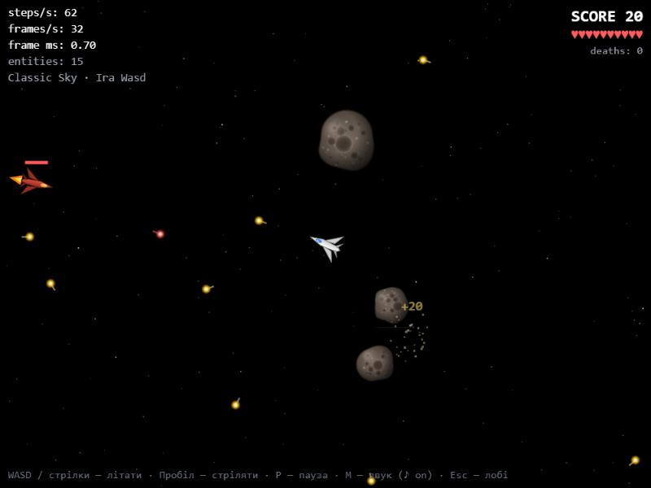
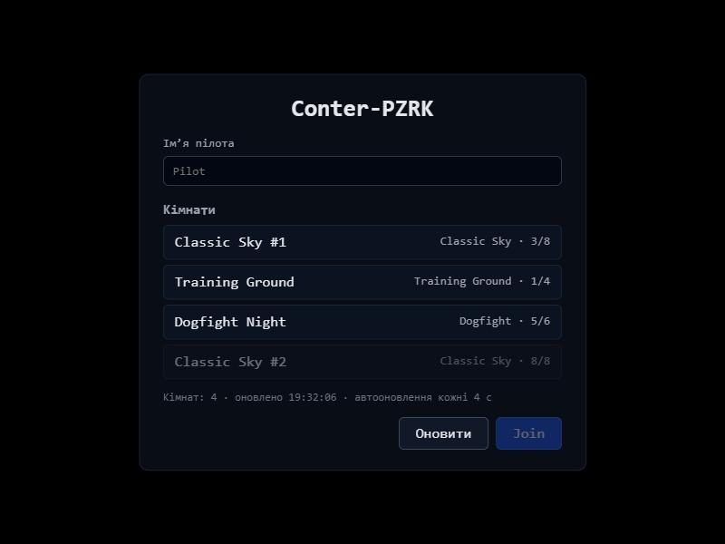
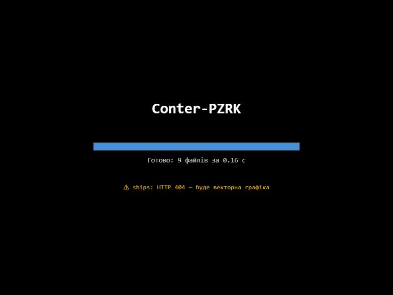
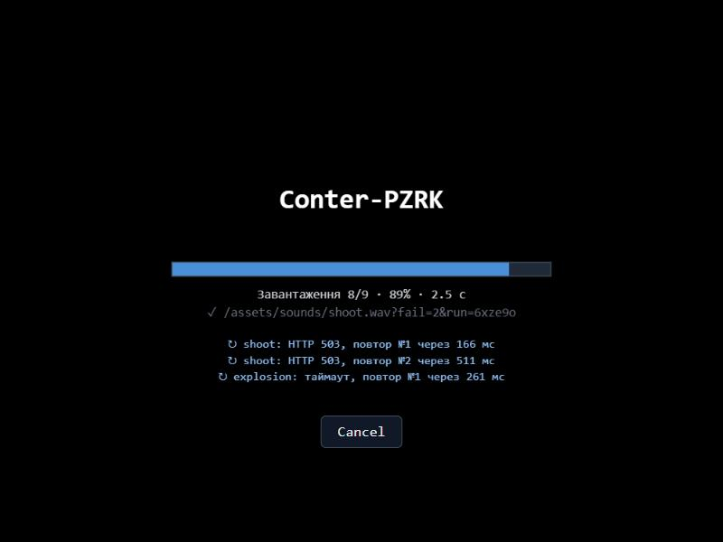
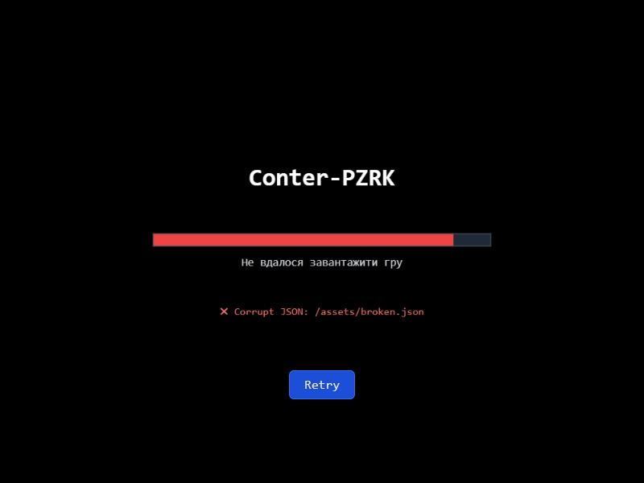

# Conter-PZRK
This is my super project about portable anti-aircraft missile system

---

Lab 1: Event Loop Is the Game Loop

## Що виконано

Зібрала ігровий цикл із фіксованим кроком симуляції (60/с) і корабель, яким можна керувати з клавіатури (WASD або стрілки). Корабель літає по canvas, повертається, прискорюється, гальмує за рахунок тертя, а при вильоті за край переміщується на протилежний край екрану.

Код розділений на окремі модулі: цикл (`loop.js`), введення (`input.js`), фізика корабля (`sim/ship.js`, `sim/arena.js`) та рендер (`render/canvas.js`,`render/draw.js`). Фізика повністю відокремлена від canvas.

## Milestone M1 - игровий цикл

Реалізовано через `requestAnimationFrame` з паттерном «акумулятор»: фізика рахується 60 разів/сек незалежно від частоти оновлення екрану, а відмальовування відбувається з тією частотою, яку підтримує монітор.
Різниця між двома станами фізики (попереднім і поточним) використовується для плавної інтерполяції під час рендеру (alpha від 0 до 1).

На моєму моніторі (частота оновлення: 144 Hz):
steps/s: стабільно ~60
frames/s: ~0.20

## Milestone M2 - введення та фізика

Введення реалізовано через замикання (`createInput`) - приватний стан натиснутих клавіш недоступний ззовні, доступ до нього здійснюється тільки через `isDown`/`justPressed`. Фізика корабля (`integrate`) - чиста функція без жодного звернення до DOM або canvas: вона приймає стан + введення + dt та повертає новий стан.

Керування - WASD та стрылки.


## Milestone M3 - інтерполяція та рендер

Рендер зберігає два стани корабля (previous/current) і малює корабель у проміжній позиції між ними за допомогою lerp. Для кута повороту використовується окрема функція lerpAngle, яка бере найкоротший шлях по колу. Інакше при переході через 0°/360° корабель різко «смикався» б у зворотний бік.

Окремо вирішила проблему інтерполяції під час переміщення корабля через край арени. Без цього виправлення корабель на мить «проїжджав» через весь екран по прямій при вильоті за межі, тому що інтерполяція чесно малювала шлях між старою позицією (біля краю) і новою (на протилежному боці).
Виправила це тим, що при виявленні переміщення через край у wrapAround примусово прирівнюю previousShip до нової позиції. Тоді інтерполяція для цього кадру нічого не «розтягує».

## Milestone M4 - три експерименти
### Експеримент 1: busy-wait в render

Додала `while (performance.now() < t + 100) {}` всередину render один раз на 60 кадрів: картинка завмирає ривками приблизно раз на секунду, HUD показує різке падіння frames/s у момент завмирання.

Так стається, бо JavaScript виконується однопоточно. Поки while займає стек, event loop не може передати керування нічому іншому - ні наступному кадру рендеру, ні обробці введення. Блокування синхронним кодом не можна обійти всередині того самого потоку. Можна або не виконувати такі довгі синхронні операції, або віддати їх Web API.

### Eксперимент 2: setInterval замість requestAnimationFrame

Замінила `requestAnimationFrame(frame)` на
`setInterval(() => frame(performance.now()), 16)`.

Частота кадрів стрибає замість тоо щоб зафіксуватися на 144Hz

При згортанні вкладки на 5 секунд setInterval продовжував працювати у фоні, а requestAnimationFrame майже зупиняється на неактивній вкладці, економлячи батарею.

Повернула requestAnimationFrame назад на своє заслужене місце.

### Експеримент 3: без фіксованого кроку (змінний timestep)

Тимчасово замінила акумулятор на simulate(delta), який викликається один раз за кадр, без циклу while і без фіксованого кроку.У DevTools сповільнила CPU (Performance -> CPU throttling -> 6x slowdown). Тримала W протягом декількох секунд. Під час цього позиції відрізняються - при змінному кроці результат фізики залежить від того, з якою частотою викликається кадр. Через це симуляція стає недетермінованою. І для нас це критично, тому що два гравці могли б бачити різну фізику.

Повернула фіксований крок назад. Після цього позиції при throttling і без нього збігаються, тому що фізика рахується однаковими фіксованими частинами часу незалежно від частоти кадрів.

## Керування

W / стрілка вверх - ру хвперед(ніс корабля)
A / стрілка вліво - поворот вліво
D / стрілка вправо - поворот вправо


---

# Lab 2: Objects, Prototypes, and `this` — сутності, кулі, колізії

## Що виконано

Гра перетворилась з «одного самолітика» на арену: мій літак стріляє, з країв екрана прилітають астероїди та ворожі літаки, вороги переслідують і стріляють у відповідь, з часом з'являються бонуси. Збиті астероїди розколюються на менші, збитий літак вибухає частинками, гравець через 2 с респауниться в безпечному місці. Очки, здоров'я і активні бонуси видно в HUD. Що більше очок — то більше ворогів одночасно (до 5).

Свою ідею з Lab 1 (самолітик з крилами, кабіною і анімованим полум'ям) залишила: тепер вороги — це той самий літак, але в темно-червоних кольорах і з полоскою HP над ним. Також додала зоряне небо на фоні, щоб рух було краще видно.

Нові модулі:

```txt
src/sim/
  vector.js      # Vector2 — незмінні (pure) методи
  entity.js      # базовий клас Entity: id, pos, vel, angle, radius, alive, kind
  ship.js        # Ship extends Entity — і гравець, і вороги; #hp, fire()
  bullet.js      # Bullet extends Entity — з TTL
  asteroid.js    # Asteroid extends Entity — дрейфує, відбивається від країв, розколюється
  pickup.js      # Pickup extends Entity — бонус, стоїть на місці
  explosion.js   # Explosion extends Entity — частинки, без колізій
  components.js  # КОМПОЗИЦІЯ: homing, контролери (мозок корабля), ефекти бонусів
  world.js       # World — менеджер сутностей на Map
  collision.js   # система колізій (детекція + правила реакції)
  spawner.js     # «режисер» хвиль: генерує астероїди, ворогів, бонуси
  random.js      # детермінований генератор випадкових чисел (seed)
```

У `sim/` як і раніше немає жодного звернення до DOM чи canvas. Це перевірила, запустивши всю симуляцію в Node без браузера (бот замість клавіатури): 2 хвилини гри, 7200 кроків, усе працює.

## Milestone M1 — `Vector2` і базовий `Entity`

`Vector2` має `add`, `sub`, `scale`, `length`, `normalize`, `rotate`, `dot`, `static fromAngle` (плюс `distanceTo`, `angle`, `clampLength`). Усі методи повертають **новий** вектор, `a.add(b)` ніколи не змінює `a`. Бонус від цього: для інтерполяції досить написати `prevPos = pos` — копіювати не треба, бо старий вектор ніхто не змінить. In-place варіантів поки не робила: на ~20–30 сутностях різниці не видно, виміряю в Lab 7.

`Entity` має приватний статичний лічильник:

```js
static #nextId = 1
#id = Entity.#nextId++
get id() { return this.#id }
```

Ззовні id можна лише прочитати, змінити — ні. Корабель з Lab 1 (простий об'єкт + функція `integrate`) переписала в `class Ship extends Entity` — рівно один рівень успадкування. Те саме для `Bullet`, `Asteroid`, `Pickup`, `Explosion` — усі напряму від `Entity`, глибше нікого немає.

**Тюнінг фізики.** У Lab 1 стояло `THRUST_POWER = 1e25` і `DRAG = 0.89`: літак миттєво набирав максимальну швидкість і миттєво зупинявся. Для куль це погано — куля успадковує швидкість літака, а «миттєва» швидкість робить це непомітним. Поставила `thrustPower = 900` px/с² і `DRAG = 0.97` за крок: літак розганяється приблизно за пів секунди і плавно гальмує десь за секунду. Вороги повільніші (`maxSpeed 190` проти `300`, поворот `2.6` проти `6` рад/с), щоб від них можна було втекти.

## Milestone M2 — світ на `Map`

`World` тримає `#entities = new Map()` (id → сутність) і має `spawn`, `despawn`, `get`, `[Symbol.iterator]` і генератор `*ofKind(kind)`:

```js
*[Symbol.iterator]() { yield* this.#entities.values() }
*ofKind(kind) { for (const e of this) if (e.kind === kind) yield e }
```

Рендер так і малює: `for (const b of world.ofKind('bullet')) drawBullet(...)` — без проміжних масивів.

`World.step(dt, input)` за один крок: зберігає попередній стан кожної сутності (для інтерполяції) → homing → `update` усіх → колізії → спавнер → прибирання мертвих.

Два моменти, де `Map` може підставити:

1. **Видалення.** `despawn(id)` нічого не видаляє, лише ставить `alive = false`. Справжнє видалення робиться в одному місці — `#sweep()` наприкінці кроку.
2. **Додавання.** Цього в завданні не було, але це легко пропустити: `for…of` по `Map` **бачить елементи, додані під час обходу**. Куля, випущена в `ship.update()`, оновилась би ще на цьому ж кроці (і пролетіла б зайвий крок). Тому все, що народжується під час кроку, спочатку йде в чергу `#pending` і додається в `Map` після кроку.

Чому `Map`, а не `{}`: ключі-числа залишаються числами (`{}` перетворює їх на рядки), є `.size`, порядок вставки гарантований, немає успадкованих ключів типу `constructor`, і він швидший при частих додаваннях/видаленнях — а кулі живуть усього 1.2 с.

`Ship.fire()` створює кулю біля носа літака, швидкість кулі = швидкість літака + 600 px/с у напрямку носа (inherited velocity). Затиснутий пробіл — 10 пострілів на секунду (`fireCooldown = 0.1` с), з бонусом R — 20.

### Баг з `this`

Відтворила навмисно в консолі DevTools: передала метод як callback, а не викликала його.

```js
window.addEventListener('keydown', game.player.fire)
// натискаємо будь-яку клавішу:
// Uncaught TypeError: Cannot read properties of undefined (reading 'has')
```

Що відбулося: браузер викликає обробник як `listener.call(window, event)`, тому всередині `fire` маємо `this === window`. `this.cooldown` у window немає (це `undefined`, тому перевірка кулдауну мовчки проходить), а потім `this.effects.has(...)` падає, бо `window.effects` — `undefined`.

Якщо просто «відірвати» метод від об'єкта, буде інша помилка:

```js
const fire = game.player.fire
fire(game.world)
// TypeError: Cannot read properties of undefined (reading 'cooldown')
```

Тут `this === undefined`, бо класи і модулі завжди в strict mode (правило default binding).

Головне правило: `this` визначається **в момент виклику**, а не тим, «чий це метод». Порядок правил: `new` → `call/apply/bind` → `obj.f()` (те, що зліва від крапки) → голий `f()` (`undefined` у strict).

Варіанти виправлення:

| Варіант | Плюс | Мінус |
|---|---|---|
| `() => ship.fire(world)` — обгортка-стрілка | найпростіше, видно, хто викликається | для `removeEventListener` треба зберегти посилання на обгортку |
| `ship.fire.bind(ship)` | `this` прив'язаний назавжди | кожен `bind` — нова функція; теж треба зберігати для `remove` |
| `fire = () => {…}` як поле класу | `this` завжди правильний, можна передавати куди завгодно | окрема функція в **кожному** екземплярі (не в прототипі) — для сотень об'єктів це зайва пам'ять |

**Що обрала я:** взагалі не підписувати методи кораблів на події. Клавіатура лише записує стан клавіш (`createInput` з Lab 1), а в кроці симуляції корабель сам викликає `this.fire(world)` — через крапку, тобто implicit binding, і `this` завжди правильний. До того ж стрільба тоді йде у фіксованому кроці симуляції, а не «коли прийшла подія» — це важливо для детермінізму і для мультиплеєра в Lab 5.

## Milestone M3 — колізії, шкода, респаун

`collision.js` розділений на дві частини:

- `findCollisions(world)` — генератор, який віддає пари `[a, b]`, що перетинаються (коло–коло, порівнюю квадрати відстаней, без `Math.sqrt`). Наївне O(n²).
- `resolveCollisions(world, pairs)` — правила реакції за парою типів: `'asteroid:bullet'`, `'bullet:ship'`, `'asteroid:ship'`, `'ship:ship'`, `'pickup:ship'`.

Функція детекції передається у `World` як параметр (`new World({ detectCollisions })`), тож у Lab 7 її можна замінити на spatial hash, не чіпаючи нічого іншого.

Правила:

- куля влучає в чужий літак (своїх не б'є) або в астероїд;
- великий астероїд має 3 HP, середній — 2, малий — 1; знищений розколюється на два менші;
- зіткнення з астероїдом: −1 HP літаку, астероїд руйнується;
- зіткнення двох літаків різних команд: обидва −1 HP і відштовхуються.

**`#hp` — приватне поле** у `Ship`, назовні тільки `get hp()`. Змінити здоров'я можна лише через `damage()` (і через респаун). Перевірила: `Object.keys(ship)` не містить `hp`, а `ship.#hp` поза класом — `SyntaxError` ще до запуску.

**Вибух** — сутність `Explosion` з 24–40 частинками, живе 0.9 с, без колізій.

**Респаун:** літак гравця не видаляється зі світу — він переходить у стан очікування (`respawnIn = 2`, `collidable = false`), а через 2 с з'являється в «безпечній» точці (`world.findSafeSpot()` — до 40 випадкових спроб знайти місце далі ніж 170 px від астероїдів, ворогів і куль). Ще 2 с після цього він невразливий і блимає. Вороги після смерті видаляються, а спавнер з часом присилає нових.

**Очки:** великий астероїд 20, середній 50, малий 100, ворожий літак 150.

**Баланс.** Спочатку в гравця було 3 HP, стрільба раз на 0.22 с і до 12 астероїдів одночасно — коли я пограла, виявилось, що вмираєш приблизно кожні 30 секунд і просто не встигаєш грати. Змінила:

| Параметр | Було | Стало |
|---|---|---|
| HP гравця | 3 | 10 |
| Пауза між пострілами | 0.22 с | 0.1 с (10 куль/с) |
| Швидкість кулі | 520 px/с | 600 px/с |
| Астероїдів на старті | 4 | 2 |
| Новий астероїд | кожні 3 с | кожні 7 с |
| Максимум астероїдів | 4 + рівень (до 12) | 2 + рівень/2 (до 5) |
| Самонавідних астероїдів | ~20% | ~10% |

Перевірила тим самим ботом у Node (стоїть на місці, повертається до найближчої цілі й стріляє), 2 хвилини гри: було 14 смертей, стало 2; астероїдів на екрані одночасно (разом з уламками) максимум 7 замість 14.

**Вигляд астероїдів.** Астероїди тепер схожі на справжні камені: нерівний скруглений контур, один великий кратер і кілька дрібних, пил і камінці на поверхні, а також об'єм — освітлена сторона (світло зверху зліва) і темна тінь з протилежного боку. Кратери «правильно» освітлені: стінка, ближча до світла, в тіні, а дальня — світла. Тінь від усього каменя рахується в екранних координатах, тому коли астероїд обертається, кратери крутяться разом з ним, а світло лишається з того самого боку. Положення кратерів генерується в симуляції з `world.rng` (як і форма контуру), тож це теж детерміновано. Самонавідні астероїди — розпечені червонуваті камені з червоним контуром.

**Детермінізм.** Усе випадкове в симуляції (форма астероїдів, де з'являються вороги, частинки) береться з `world.rng` із seed, а не з `Math.random()`. Перевірила в Node: два запуски по 2 хвилини з тим самим seed дають однакові позиції, очки і кількість смертей. `Math.random()` залишився лише у фоні зі зірками — це чисто декорація.

## Milestone M4 — композиція замість ієрархії

Дві фічі, які зламали б дерево класів:

**(a) Homing (самонаведення)** — один компонент і для кулі, **і** для астероїда:

```js
bullet.homing = homing({ turnRate: 5, targetKinds: ['ship', 'asteroid'], ownTeam: 'player' })
asteroid.homing = homing({ turnRate: 0.9, targetKinds: ['ship'], ownTeam: 'neutral' })
```

Це звичайний об'єкт з даними. Окрема система `homingSystem(world, dt)` проходить по всіх сутностях і, якщо в сутності є поле `homing`, повертає її швидкість у бік найближчої цілі (не більше `turnRate` рад/с, модуль швидкості не змінюється). Їй байдуже, куля це чи астероїд. Приблизно 10% нових астероїдів — маленькі червоні «самонавідні», а кулі стають самонавідними, коли гравець підбирає бонус **H**. Перевірка: постріл під 90° від цілі — звичайна куля промахується (HP цілі 3), самонавідна влучає (HP 2).

**(b) Pickup (бонус)** — стоїть на місці, з ним можна зіткнутись, але це не корабель. Який ефект він дає — просто рядок: `'shield'` (**S**, щит 6 с), `'rapid'` (**R**, скорострільність 6 с), `'homing'` (**H**, самонавідні кулі 8 с). На кораблі активні ефекти лежать у `ship.effects` — `Map<назва, секунд залишилось>`, і корабель просто питає `effects.has('rapid')`.

Так само зроблений **«мозок» корабля**: `ship.controller` — це рядок `'keyboard'` або `'chaser'`. Гравець і ворог — той самий клас `Ship`, відрізняються лише контролер і числа.

**Як виглядало б через успадкування:**

```txt
Entity
├── MovingEntity
│   ├── Bullet
│   │   └── HomingBullet          ← копія логіки наведення №1
│   ├── Asteroid
│   │   └── HomingAsteroid        ← копія логіки наведення №2
│   └── Ship
│       ├── PlayerShip
│       │   ├── ShieldedPlayerShip
│       │   └── RapidFirePlayerShip   ← а якщо щит І скорострільність одночасно?
│       └── EnemyShip
└── Pickup                         ← не рухається, але колізії потрібні
```

Проблеми: логіка наведення дублюється у двох гілках (або потрібен спільний предок `HomingThing`, а з одним `extends` у Bullet уже є свій предок); комбінації бонусів дають вибух кількості класів; бонус діє 6 секунд — а клас об'єкта під час гри не поміняєш. Будь-яка нова ідея («астероїд, що стріляє») вимагає перебудувати дерево.

**Чому обрала композицію саме так (поведінка як дані):** компоненти — це прості поля з рядками і числами (`homing`, `effects`, `controller`), а логіка живе в системах (`homingSystem`, контролери, правила колізій). Додати/зняти поведінку під час гри — просто присвоїти або видалити поле. Плюс такі дані легко серіалізувати в JSON — у Lab 5 стан світу доведеться передавати по мережі, а функції і класи по мережі не передаш.

## Досліди з notes (консоль)

1. `b = Object.create(a)`: `b.hello` → `1`, `hasOwnProperty('hello')` → `false`, після `a.hello = 2` → `b.hello` теж `2`. Властивість не копіюється, а шукається вгору по прототипу — тому тисяча куль ділить один метод `update`.
2. `const m = a.m; m()` → `undefined` (default binding у strict mode), `m.call(a)` → `A {}`.
3. `{ 1: 'x' }`: `o[1]` і `o['1']` — обидва `'x'`, бо ключ став рядком. `Map`: `get(1)` → `'x'`, `get('1')` → `undefined`. Об'єкт як ключ у `{}` перетворюється на `'[object Object]'`.

## ESLint / Prettier

У Lab 1 ESLint і Prettier були встановлені, але не налаштовані. Додала `eslint.config.js` (flat config: `@eslint/js` recommended + `eslint-config-prettier`) і `.prettierrc`. Скрипти: `npm run lint` (0 помилок) і `npm run format`.

## Керування

W / стрілка вгору — тяга вперед
A / D або стрілки вліво/вправо — поворот
Пробіл — стріляти
P — пауза (зроблено через `justPressed`: одне натискання = одне перемикання)

Запуск: `npm install`, потім `npm run dev`.


---

# Lab 3: Asynchronous JavaScript — завантаження, лобі, звук

## Що виконано

Тепер гра починається не одразу, а як справжня: **екран завантаження** з прогрес-баром → **лобі** з кімнатами → **гра** зі спрайтами і звуком. Esc повертає з гри в лобі.



- Спрайт-листи (літаки, кулі, астероїди), 5 звуків і конфіг арен вантажаться **паралельно** через `Promise.all`, з прогресом по кожному файлу.
- Кожен запит має таймаут, повтори з експоненційною затримкою та jitter, і його можна скасувати.
- Якщо необов'язковий файл не завантажився, гра все одно стартує: замість спрайта малюється векторна графіка з Lab 1–2, замість звуку — тиша. Якщо не завантажився обов'язковий файл (конфіг арен), з'являється зрозуміле повідомлення і кнопка **Retry**.
- Лобі вантажить список кімнат по HTTP, оновлює його кожні 4 с, має таймаут 3 с і скасовує запити, щойно гравець виходить.
- Звук через Web Audio API, вмикається першим кліком/клавішею. Симуляція про звук нічого не знає — вона лише оголошує події.
- 3 арени з різними правилами: **Classic Sky**, **Training Ground** (мало ворогів, без самонавідних астероїдів), **Dogfight** (без астероїдів, до 6 ворогів).

Нові файли:

```txt
public/assets/
  manifest.json          # список усіх ассетів + кадри спрайт-листів
  arenas.json            # параметри арен (обов'язковий ассет)
  sprites/*.svg          # спрайт-листи (згенеровані скриптом)
  sounds/*.wav           # звуки (згенеровані скриптом)
  broken.json            # навмисно зіпсований JSON для тестів
public/api/rooms.json    # "сервер" лобі (у Lab 4 його замінить Node-сервер)
scripts/
  make-sprites.mjs       # генерує SVG-спрайти
  make-sounds.mjs        # синтезує WAV-звуки
src/
  assets/loader.js       # fetchJson, withRetry, loadImage/Audio/Json, loadAll
  assets/test-flags.js   # навмисні збої для галереї помилок (?test=...)
  audio.js               # AudioContext, розблокування, підписка на події світу
  hud.js                 # HUD як підписник подій ("+50", банер бонусу)
  lobby/lobby.js         # class Lobby extends EventTarget — логіка без DOM
  lobby/lobby-view.js    # DOM-відображення лобі
  render/loading.js      # екран завантаження на canvas
tests/loader.test.js     # 13 тестів (node:test)
vite.config.js           # middleware: повільна/ненадійна мережа і справжній 404
```

**Спрайти і звуки я не брала з інтернету, а згенерувала кодом** (`npm run assets`): SVG-спрайти будуються з тих самих координат, що й мій векторний літак, а звуки синтезуються в WAV (постріл — квадратна хвиля з падінням частоти, вибух — шум через фільтр, бонус — три ноти вгору). Так немає проблем з ліцензіями, і все можна перегенерувати, змінивши пару чисел.

## Milestone M1 — конвеєр ассетів і екран завантаження

`src/assets/loader.js`:

- **`fetchJson(url, { signal, timeoutMs })`** — перевіряє `res.ok`. `fetch` НЕ відхиляє проміс на 404/500: сервер же відповів. Тому `!res.ok` я сама перетворюю на `HttpError`. Тіло читається окремим `await res.text()` (другий крок, який теж може впасти), а битий JSON стає `AssetFormatError`.
- **`loadImage`, `loadAudio(ctx, url)`, `loadJson`** — усі приймають `AbortSignal`. Картинка: `fetch → blob → Image → img.decode()`. Звук: `fetch → arrayBuffer → audioCtx.decodeAudioData()` (декодувати можна ще до кліку, поки контекст «suspended»).
- **Таймаут на кожну спробу:** `AbortSignal.any([signal, AbortSignal.timeout(ms)])`. Скасувала користувачка → `AbortError`, сервер не встиг → `TimeoutError`. Це різні помилки, і обробляються вони по-різному.
- **`withRetry(fn, { attempts, baseMs, signal })`** — експоненційна затримка з jitter: пауза після спроби *n* береться випадково з `[base·2ⁿ⁻¹/2, base·2ⁿ⁻¹]`. Jitter потрібен, щоб після падіння сервера тисяча клієнтів не прийшла знову в ту саму мілісекунду.

Що повторюємо, а що ні:

| Помилка | Повтор? | Чому |
|---|---|---|
| HTTP 500/503, 408, 429 | так | сервер тимчасово не справляється |
| мережа (`TypeError`), таймаут | так | з'єднання могло відновитись |
| HTTP 404, 403 та інші 4xx | **ні** | файлу немає — хоч 100 разів питай |
| битий JSON / картинка не декодується | **ні** | файл зіпсований, а не мережа |
| `AbortError` | **ні** | користувачка сама скасувала |

- **`loadAll(manifest, { onProgress, signal })`** — `Promise.all`, але кожен проміс обгорнутий у `.then(...)`, який рахує `done++` і викликає `onProgress`. Сам `Promise.all` нічого не каже до самого кінця, тому прогрес треба рахувати так. Необов'язкові файли (`"optional": true`) при помилці повертають `null` і записуються в `failed`. Обов'язкові та `AbortError` передаються далі, і тоді весь `Promise.all` відхиляється.
- **Екран завантаження** (`render/loading.js`) малюється на canvas у `requestAnimationFrame`, поки йде завантаження. На ньому справжній відсоток, час, останній файл, повтори (`↻`) і попередження (`⚠`). Гра стартує лише після `await loadAll(...)`.

### Паралельно vs послідовно

9 файлів, кожен сервер віддає з затримкою 400 мс (`?test=slowall`). Заміряла в браузері по 3 рази (`loadAll` проти `loadAllSequential`, у якому ті самі файли вантажаться в циклі `for` з `await`):

| | Запуск 1 | Запуск 2 | Запуск 3 |
|---|---|---|---|
| `Promise.all` (паралельно) | 824 мс | 831 мс | 831 мс |
| `await` по черзі | 3736 мс | 3728 мс | 3772 мс |

Послідовно в **~4.5 раза повільніше**: 9 × 400 мс = 3600 мс плюс накладні витрати. Цікаво, що паралельно вийшло не 400 мс, а дві «хвилі» по 400. Браузер тримає **не більше 6 одночасних HTTP/1.1-з'єднань з одним сервером**: спочатку йдуть 6 файлів, потім решта 3. Тобто `Promise.all` запускає всі запити одразу, але браузер сам ставить зайві в чергу.

## Milestone M2 — спрайти і звук

**Спрайти.** `drawImage(sheet, sx, sy, sw, sh, dx, dy, dw, dh)` — береться прямокутник з листа. Координати кадрів лежать у `manifest.json`: літак 128×128 малюється в 44×44, куля 32×32 → 13×13, астероїд 128×128 → під свій радіус.

З астероїдами була цікава проблема: у Lab 2 я зробила так, що камінь обертається, а **світло падає завжди зверху зліва**. Якщо просто обертати спрайт, тінь крутилася б разом з каменем. Тому астероїд збирається на маленькому допоміжному canvas: (1) малюю повернутий кадр, (2) зверху режимом `globalCompositeOperation = 'source-atop'` (малювати лише там, де вже є камінь) кладу НЕповернутий градієнт тіні, (3) копіюю результат на екран. У SVG-спрайті тому немає «запеченого» освітлення, а кратери намальовані нейтрально.

Якщо спрайт не завантажився, кожен тип сутності має запасний варіант — векторне малювання з Lab 1–2.

**Звук.** `audio.js` володіє `AudioContext`. Браузер не дає відтворювати звук до жесту користувача, тому контекст «розблоковується» (`ctx.resume()`) першим `pointerdown`/`keydown` або кліком Join. Кожен звук — новий `AudioBufferSourceNode` з уже декодованим буфером (декодування відбувається під час завантаження, а не під час гри). Щоб 20 пострілів на секунду не злились у гул, той самий звук не грає частіше, ніж раз на 30 мс. Маленький астероїд вибухає тихіше й вище (`playbackRate`), літак — на повну. M — вимкнути звук.

**Події замість імпортів.** `World` тепер `extends EventTarget` і оголошує `CustomEvent`-и:

| Подія | Коли | Хто слухає |
|---|---|---|
| `fired` | постріл | звук (свій / ворожий постріл) |
| `hit` | влучання без знищення | звук |
| `exploded` | знищено корабель або астероїд | звук (гучність залежить від розміру) |
| `pickup` | підібрано бонус | звук + HUD (банер «SHIELD!») |
| `score` | нараховано очки | HUD (спливаюче «+50», очки блимають) |

**У `src/sim/` немає жодного імпорту `audio.js` чи `hud.js`** — це перевіряє окремий тест (`tests/loader.test.js`, останній тест читає всі файли `sim/`). Тому симуляцію досі можна запускати в Node без браузера, і в Lab 4–5 вона зможе працювати на сервері, де немає ні звуку, ні екрана.

## Milestone M3 — лобі по HTTP



`class Lobby extends EventTarget` (`lobby/lobby.js`) — лише логіка, без DOM:

- `open()` створює `AbortController`, одразу викликає `refresh()` і ставить `setInterval` на кожні 4 с;
- `refresh()` робить запит з сигналом `AbortSignal.any([leave, AbortSignal.timeout(3000)])`, тобто запит переривається, якщо гравець пішов з лобі **або** сервер мовчить довше 3 с;
- `join(roomId, name)` перевіряє, що кімната існує і не заповнена, закриває лобі й оголошує `join`;
- `close()` викликає `controller.abort()` — **один сигнал прибирає і таймер, і запит у польоті**. Жодних «осиротілих» запитів.

Події: `rooms`, `error`, `loading`, `join`, `close`. Відображення (`lobby/lobby-view.js`) — окремий модуль, який просто слухає ці події й малює DOM. Назви кімнат приходять із сервера, тому лише `textContent`, ніякого `innerHTML`. Ім'я пілота зберігається в `localStorage`. Заповнена кімната (8/8) показується сірою, вибрати її не можна. Join запускає локальну гру з параметрами арени цієї кімнати.

Перевірка (`?test=lobbyslow`, сервер відповідає через 5 с):
- через 3 с лобі пише «Сервер не відповів за 3 с — спробую ще раз автоматично» (`stats.failed: 1`);
- натискаю Join, поки висить наступний запит → `stats.aborted: 1`, у вкладці Network запит позначений `(canceled)` / `net::ERR_ABORTED`.

Знайшла баг, поки робила лобі: у полі імені не друкувались пробіл і літери W/A/S/D, бо `input.js` з Lab 1 перехоплював клавіші для гри (`preventDefault` на пробілі). Виправила: якщо подія прийшла з `<input>`, гра її ігнорує.

І ще один баг у `loop.js`: `stop()` викликається зсередини кадру (Esc → лобі), але кадр наприкінці знову викликав `requestAnimationFrame(frame)`, і цикл не зупинявся. Додала прапорець `running`, а `start()` тепер скидає накопичений час, щоб після лобі не було ривка.

## Milestone M4

### (a) П'ять головоломок порядку виконання

Усі п'ять я запускала: 1–4 в Node, 5 у браузері (5 разів, порядок однаковий).

**1. `await` віддає керування**
```js
console.log('A')
async function f() {
  console.log('B')
  await null
  console.log('C')
}
f().then(() => console.log('D'))
console.log('E')
```
Вивід: `A B E C D`. Тіло `async`-функції до першого `await` виконується синхронно (`B`). `await null` ставить продовження в чергу мікрозадач, і функція повертає керування, тому `E` друкується раніше за `C`. `D` — ще одна мікрозадача після завершення `f`.

**2. `setTimeout` всередині `.then`**
```js
setTimeout(() => console.log('1'), 0)
Promise.resolve()
  .then(() => {
    console.log('2')
    setTimeout(() => console.log('3'), 0)
  })
  .then(() => console.log('4'))
queueMicrotask(() => console.log('5'))
```
Вивід: `2 5 4 1 3`. Спочатку всі мікрозадачі: `2`, потім `5` (стала в чергу раніше, ніж другий `.then`), потім `4`. Далі таймери в порядку постановки: `1` поставлений першим, `3` — лише під час мікрозадачі, тому він останній.

**3. Ассет, який уже завантажився**
```js
const loaded = Promise.resolve('ship.svg')
setTimeout(() => console.log('timer'), 0)
loaded.then((n) => console.log('then', n))
;(async () => {
  console.log('async start')
  const n = await loaded
  console.log('async got', n)
})()
console.log('sync end')
```
Вивід: `async start`, `sync end`, `then ship.svg`, `async got ship.svg`, `timer`. Навіть коли проміс уже виконаний, `.then` і `await` НЕ спрацьовують синхронно — завжди через мікрозадачу. `.then` підписався першим, тому й спрацював першим. Таймер — макрозадача, він чекає, поки черга мікрозадач спорожніє.

**4. `return` проміса з `async` коштує зайвих «тіків»**
```js
async function a() {
  return Promise.resolve('a')
}
async function b() {
  return 'b'
}
a().then((v) => console.log(v))
b().then((v) => console.log(v))
Promise.resolve()
  .then(() => console.log('c1'))
  .then(() => console.log('c2'))
  .then(() => console.log('c3'))
  .then(() => console.log('c4'))
```
Вивід: `b c1 c2 a c3 c4`. `b` повертає звичайне значення, і її проміс виконується одразу. `a` повертає **проміс**, тож рушію треба його «розпакувати»: спершу мікрозадача, що підписується на внутрішній проміс (`then`), потім ще одна, коли той виконується. Через це `a` відстає на 2 тіки від ланцюжка `c`.

**5. `requestAnimationFrame`** (браузер)
```js
requestAnimationFrame(() => {
  log('raf')
  Promise.resolve().then(() => log('raf-micro'))
  setTimeout(() => log('raf-timeout'), 0)
})
setTimeout(() => log('timeout'), 0)
Promise.resolve().then(() => log('micro'))
log('sync')
```
Вивід (5 запусків з 5): `sync micro timeout raf raf-micro raf-timeout`. Синхронне → мікрозадачі → таймер (наступна задача) → rAF виконується лише перед відмальовуванням кадру, а це до ~16 мс → мікрозадача з rAF виконується одразу після нього → таймер, поставлений у rAF, — аж після. Порядок `timeout` / `raf` специфікація не гарантує (залежить від того, коли буде кадр), але мікрозадачі завжди йдуть першими. І ще спостереження: коли вкладка була прихована, `raf` не спрацював зовсім — браузер не малює кадри для невидимої сторінки.

### (b) Галерея помилок

Усі збої вмикаються параметром адреси, наприклад `http://localhost:5173/?test=missing`. Затримки, 503 і 404 робить middleware у `vite.config.js`.

| Параметр | Що відбувається |
|---|---|
| `missing` | спрайт літаків → файл, якого немає |
| `slow` | спрайт астероїдів відповідає через 2.5 с |
| `slowall` | кожен файл відповідає через 400 мс |
| `timeout` | звук вибуху відповідає через 8 с при таймауті 1.5 с |
| `flaky` | звук пострілу двічі віддає 503, утретє — успіх |
| `badjson` | конфіг арен зіпсований |
| `abort` | завантаження скасовується через 1 с |
| `sequential` | вантажити по черзі замість `Promise.all` |
| `lobbyslow` | список кімнат відповідає через 5 с |

**1. Спрайт не знайдено (404)** — `?test=missing`



`HttpError 404` — без повторів (сенсу немає). Спрайт необов'язковий, тож гра стартує, а літаки малюються векторною графікою з Lab 1.

Тут я натрапила на цікаву річ: спочатку замість 404 була помилка «зіпсований файл». Виявилось, що dev-сервер Vite на **будь-яку** невідому адресу віддає `index.html` зі статусом **200** (так зручно для односторінкових застосунків). `fetch` отримував HTML і намагався декодувати його як картинку. Додала в middleware справжній 404 для відсутніх файлів у `/assets/` і `/api/`.

**2. Сервер тимчасово падає (503) і таймаут** — `?test=flaky,timeout`



Видно, як працює backoff з jitter: `shoot` двічі отримав 503 і пробував знову через 166 мс, потім 511 мс (експонента + випадковість), а з третьої спроби завантажився. `explosion` перший раз впав по таймауту і теж пішов на повтор.


Після 3 таймаутів по 1.5 с `explosion` здався. Звук необов'язковий, тож гра стартувала за 5.3 с, просто без звуку вибуху.

**3. Скасування посеред завантаження** — `?test=abort,slow`


8 з 9 файлів уже завантажились, повільний спрайт ще йшов — і тут `controller.abort()` (те саме робить кнопка Cancel). Запит обірвався (`net::ERR_ABORTED` у Network), `Promise.all` відхилився з `AbortError`, на екрані «Завантаження скасовано» і кнопка Retry. Повтору не було — скасування не помилка мережі.

**4. Зіпсований JSON** — `?test=badjson`



`arenas.json` обов'язковий: без нього не знати правил арени. `JSON.parse` падає → `AssetFormatError` (без повторів — файл зіпсований, а не мережа) → червоний екран з поясненням і кнопкою **Retry**. Retry запускає завантаження знову без навмисних збоїв (наче сервер виправили) — і гра доходить до лобі.

## Тести

`npm test` — 13 тестів на вбудованому `node:test` (Vitest буде в Lab 7), `fetch` підмінено фейком, мережа не потрібна:

- 503 повторюється до успіху; 404 і битий JSON — рівно 1 запит, без повторів; після `attempts` спроб помилка передається далі;
- мережева помилка (`TypeError`) і таймаут (`TimeoutError`) повторюються;
- паузи backoff ростуть як 4 → 8 → 16 мс (мінімум jitter) і 8 → 16 → 32 мс (максимум) при `baseMs = 8`;
- abort під час паузи між спробами зупиняє все;
- `loadAll`: прогрес на кожен файл; необов'язковий файл може впасти; обов'язковий — валить весь `loadAll`; паралельно швидше за послідовно;
- `src/sim/` не імпортує `audio`/`hud` і не звертається до `document`/`window`.

```txt
ℹ tests 13
ℹ pass 13
ℹ fail 0
```

## Керування (оновлено)

W / ↑ — тяга · A / D, ← / → — поворот · Пробіл — стріляти
P — пауза · M — вимкнути/увімкнути звук · Esc — вийти в лобі

Гру треба запускати саме через Vite (`npm run dev`, адреса http://localhost:5173), а не через Live Server чи подвійним кліком по `index.html`: ассети лежать у `public/`, і в корінь сайту їх викладає лише Vite. Інакше буде `HTTP 404 for /assets/manifest.json`. Якщо PowerShell пише «running scripts is disabled», замість `npm` пиши `npm.cmd` (наприклад `npm.cmd run dev`).

Команди: `npm run dev` — гра, `npm test` — тести, `npm run lint` — лінтер, `npm run assets` — перегенерувати спрайти і звуки.
